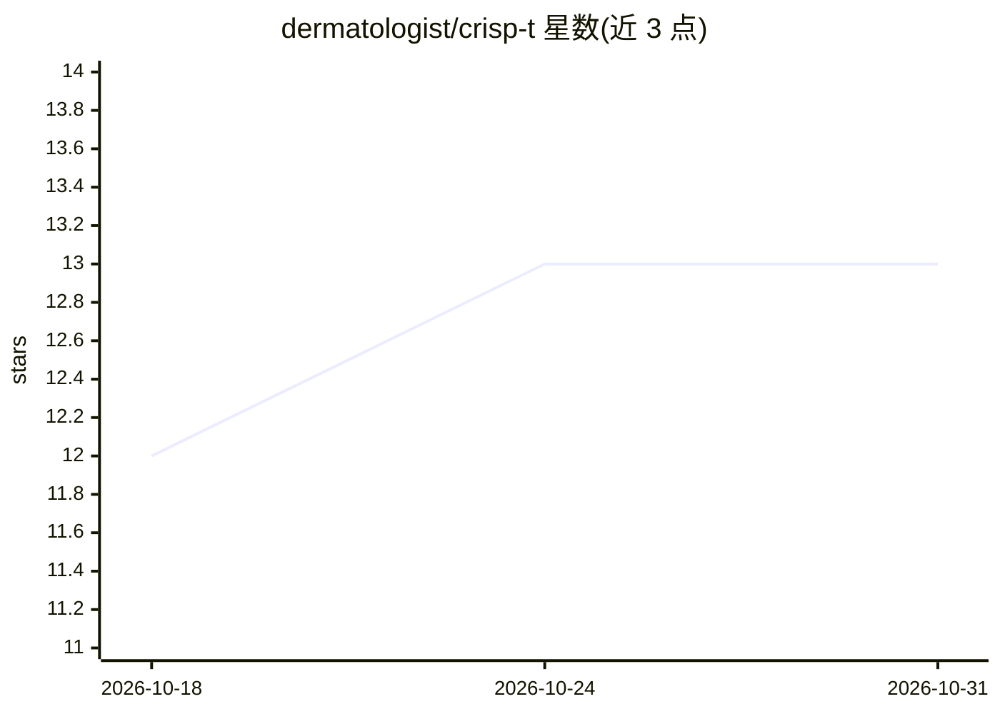

# dermatologist/crisp-t

⭐ 13 · Python · GPL-3.0 · 推送 2026-08-09 · [GitHub](https://github.com/dermatologist/crisp-t) · [官网](https://nuchange.ca/2025/10/crisp-t-ai-assisted-qualitative-research.html) · 个人维护

**面向质性研究的文本+数值混合数据分析 CLI 工具包**

CRISP-T 是一套质性研究方法与工具包，将访谈文本、田野笔记等文本数据与问卷、人口统计等数值数据整合到统一语料库，支持归纳分析（主题、情感）、聚类回归、语义搜索与可视化（词云、交互式主题图）。提供三个 CLI 工具（crisp/crispviz/crispt），无需 Python 知识即可使用。另含 MCP server 与 Skills，可接入 Claude Desktop 等 AI 编码平台，并提供基于 GitHub Copilot SDK 的 Web UI。GPL-3.0 许可，作者为 Bell Eapen（UIS）。不适用于多模态预测与分阶段混合方法研究。

## 筛选速览

| 维度 | 判定 | 备注 |
|---|---|---|
| AI 角色 | `ai-ecosystem` | LLM/agent 周边工具 |
| 许可风险 | `viral` | GPL-3.0 |
| 部署形态 | `library` | 以包/库形式分发 |
| 模型依赖 | — | README 未给出锁定关系 |
| 硬件要求 | — | 无带数字的原话,不猜 |
| 安装摩擦 | `low` | 无编译、无系统依赖或容器化 |
| 成熟度 | `idea` | |

## 能力要点

- 文本+数值统一语料库，支持主题/情感/聚类/回归分析与三角互证
- crisp、crispviz、crispt 三个 CLI 工具，无需 Python 知识
- MCP server 与 Skills 支持 Claude Desktop 等 AI 编码平台接入
- crisp-ui：基于 GitHub Copilot SDK 的浏览器界面

## 适用场景

- 我要把访谈文本和问卷数据放在一起做归纳分析与三角互证
- 我想对质性语料做语义检索和文献筛选
- 我想在 Claude Desktop 等 AI 平台中用 agent 直接分析我的数据

## 场景标签

`数据分析` `科研工具` `语义搜索` · 领域:效率与自动化

## 证据(README 行号)

> L36: **CRISP-T** integrates **textual data** (interview transcripts, field notes) and **numeric data** (surveys, demogra
> L117: ## 🤖 MCP Server (Agentic AI)

## 星数曲线

2026-10-18 12 → 2026-10-31 13（+1）

---
*卡片 v1 · prompt 1.4 · 生成 2026-10-31 · 置信度 mid · 依据 README sha `a86f14e90c2b` · [字段定义](../../DATASET.md)*
