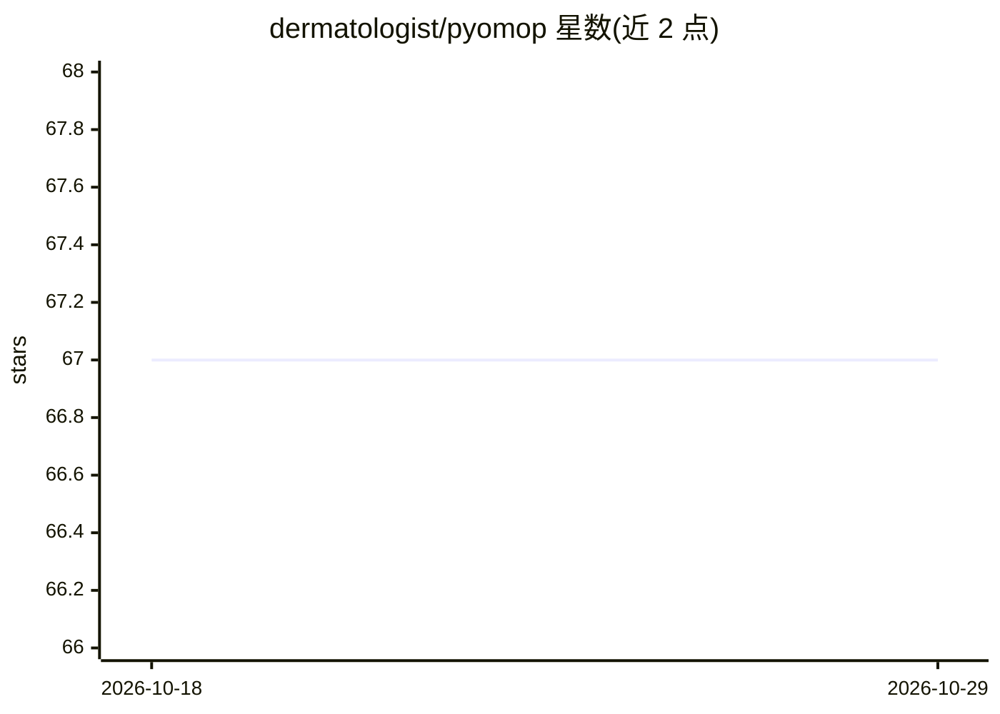

# dermatologist/pyomop

⭐ 67 · Python · GPL-3.0 · 推送 2026-10-22 · [GitHub](https://github.com/dermatologist/pyomop) · [官网](https://nuchange.ca/2025/08/vibe-coding-fhir-to-omop-cdm.html?github) · 个人维护

**管理 OHDSI OMOP 临床数据库的 Python 工具库**

面向研究者和开发者的 OMOP CDM（v5.4/v6）数据库工具库，基于 SQLAlchemy，支持 SQLite/PostgreSQL/MySQL：创建 CDM 表、加载词表、导入 FHIR Bulk NDJSON 并做概念映射、执行 OHDSI QueryLibrary、导出 PyHealth 兼容格式。AI 相关功能以可选组件提供：langchain 驱动的自然语言查询（pip install pyomop[llm]）、MCP 服务器（stdio/HTTP 传输、8 个工具）、Agent 辅助 ETL 与基于 skill 的映射 JSON 生成。

## 筛选速览

| 维度 | 判定 | 备注 |
|---|---|---|
| AI 角色 | `ai-enhanced` | 去掉 AI 部分产品仍成立 |
| 许可风险 | `viral` | GPL-3.0 |
| 部署形态 | `library` | 以包/库形式分发 |
| 模型依赖 | — | README 未给出锁定关系 |
| 硬件要求 | — | 无带数字的原话,不猜 |
| 安装摩擦 | `low` | 无编译、无系统依赖或容器化 |
| 成熟度 | — | 结构信号不足 |

## 能力要点

- FHIR Bulk NDJSON 导入 OMOP CDM 并做 source_value→concept_id 映射
- MCP 服务器（stdio/HTTP）暴露 create_cdm、run_sql 等 8 个工具，适配 Claude desktop 等 MCP 客户端
- 可选 langchain 自然语言查询（pyomop[llm]）
- Agent 辅助 ETL（beta）：--extract-schema 生成 schema Markdown 供 AI 生成映射 JSON

## 适用场景

- 在 SQLite/PostgreSQL/MySQL 上创建并管理 OMOP CDM 数据库
- 把 FHIR Bulk Export 数据转换入库做临床数据分析
- 让 Claude 等 MCP 客户端直接对 OMOP 数据库建库、查表、执行 SQL
- 导出 PyHealth 兼容格式用于医疗机器学习流程

## 场景标签

`数据分析` · 领域:效率与自动化

## 证据(README 行号)

> L15: **pyomop** is your OMOP Swiss Army Knife 🔧 for working with OHDSI OMOP Common Data Model (CDM) v5.4 or v6 compliant
> L18: - LLM-based natural language queries via langchain. Usage.

## 星数曲线

2026-10-18 67 → 2026-10-29 67（+0）

---
*卡片 v1 · prompt 1.4 · 生成 2026-10-24 · 置信度 mid · 依据 README sha `291c24b9fc82` · [字段定义](../../DATASET.md)*
