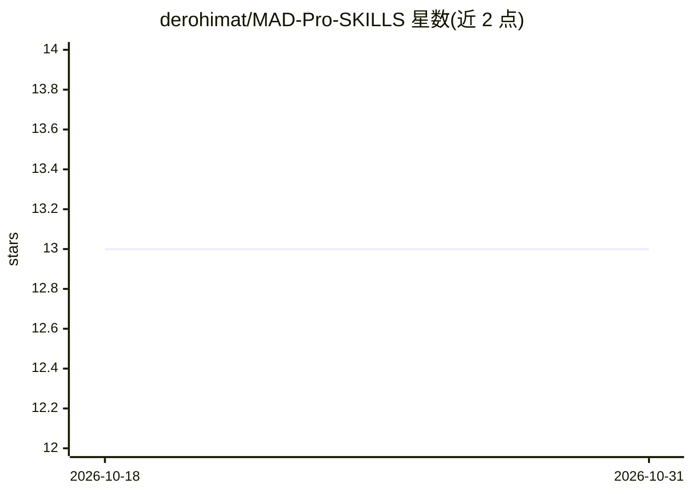

# derohimat/MAD-Pro-SKILLS

⭐ 13 · JavaScript · 推送 2026-07-16 · [GitHub](https://github.com/derohimat/MAD-Pro-SKILLS) · [官网](https://derohimat.github.io/MAD-Pro-SKILLS/) · 个人维护

**给 AI agent 注入安卓开发模式技能库的 CLI 工具**

面向 Android 开发者的 npm CLI：提供 76+ 条现代安卓开发（MAD）模式技能，覆盖 26 个类别与 23 个行业垂直领域（银行、电商、医疗等），将生产级架构模式注入 Cursor、Windsurf、Antigravity 等 AI agent 的上下文。通过 Smart Wizard 按需选择性初始化，支持搜索添加单个技能、列出清单、扫描反模式的 doctor 与动态生成系统指令等命令。以 npm 全局安装使用。

## 筛选速览

| 维度 | 判定 | 备注 |
|---|---|---|
| AI 角色 | `ai-ecosystem` | LLM/agent 周边工具 |
| 许可风险 | `permissive` | — |
| 部署形态 | `library` | 以包/库形式分发 |
| 模型依赖 | — | README 未给出锁定关系 |
| 硬件要求 | — | 无带数字的原话,不猜 |
| 安装摩擦 | `low` | 无编译、无系统依赖或容器化 |
| 成熟度 | — | 结构信号不足 |

## 能力要点

- 76+ 条 MAD 模式技能，26 类别 + 23 行业垂直领域
- Smart Wizard 按需选择类别初始化，避免无关技能
- mad-pro doctor 扫描架构反模式与安全漏洞
- 兼容 Cursor / VS Code 等多种 IDE 的 agent 环境

## 适用场景

- 让我的 Cursor/Windsurf agent 写出符合 Google 最新标准的安卓代码
- 为银行、电商等垂直领域项目注入行业蓝图技能
- 检查安卓项目中是否存在架构反模式

## 场景标签

`提示工程` · 领域:Agent 开发

## 证据(README 行号)

> L3: **Engineering Experts for your AI Agent.** Equip your development environment with 76+ professional Modern Android D
> L12: AI Agents (Cursor, Windsurf, Antigravity) are powerful but often lack specific architectural depth. **MAD Pro** inj

## 星数曲线

2026-10-18 13 → 2026-10-31 13（+0）

---
*卡片 v1 · prompt 1.4 · 生成 2026-10-31 · 置信度 high · 依据 README sha `a26660b65d4c` · [字段定义](../../DATASET.md)*
