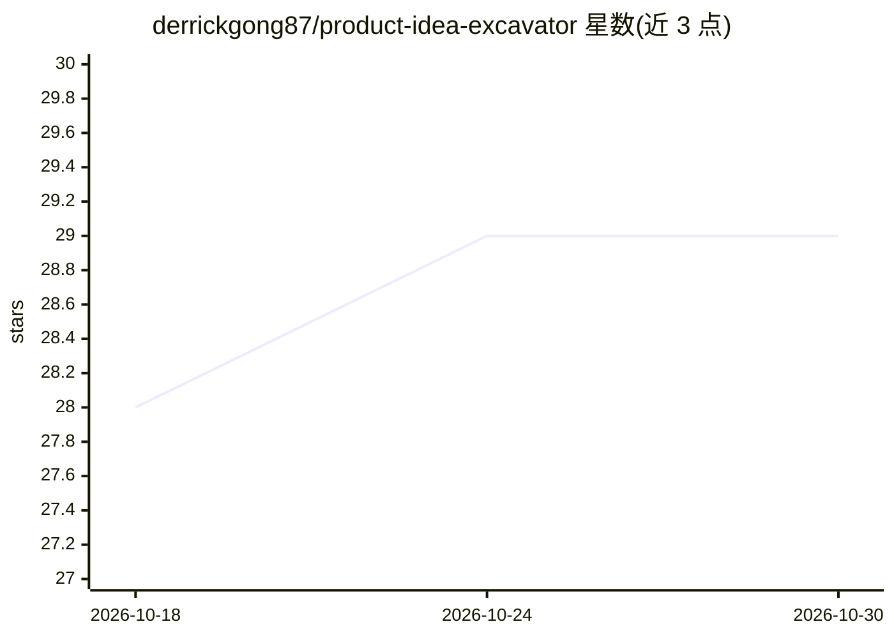

# derrickgong87/product-idea-excavator

⭐ 29 · MIT · 推送 2026-04-28 · [GitHub](https://github.com/derrickgong87/product-idea-excavator) · 个人维护 · 中文 README

**把模糊产品想法转为发现访谈与 PRD 的双语 Claude Skill**

一个面向 Claude 类助手的 agent Skill（MIT 许可），服务创始人、产品经理、独立开发者和 AI 产品团队。它不直接生成计划，而是让助手以产品经理身份主持发现访谈：澄清想法来源、定义首批真实用户、检验痛点与需求证据、收窄 MVP 切口、评估 AI/技术可行性与商业模式，共 10 个阶段，用户确认完成后自动合成结构化 PRD。中英文按提问语言路由，单会话保持单一语言。以提示词工程/参考手册形式实现，依赖宿主 agent 框架运行。

## 筛选速览

| 维度 | 判定 | 备注 |
|---|---|---|
| AI 角色 | `ai-native` | 本体是模型或模型工具 |
| 许可风险 | `permissive` | MIT |
| 部署形态 | `None` |  |
| 模型依赖 | — | README 未给出锁定关系 |
| 硬件要求 | — | 无带数字的原话,不猜 |
| 安装摩擦 | `low` | 无编译、无系统依赖或容器化 |
| 成熟度 | — | 结构信号不足 |

## 能力要点

- 10 阶段产品发现访谈流程（从想法来源到指标与风险）
- 需求证据优先：付费/预付/绕行成本等信号检验而非凭感觉
- 显式评估 AI 角色与技术栈可行性（RAG/Agent/工具调用等）
- 中英双语按提问语言自动路由，会话内保持单一语言

## 适用场景

- 我有个模糊的产品想法，想让 AI 像产品经理一样帮我盘清楚
- 写 PRD 前先被追问用户、痛点与 MVP 范围
- AI 产品立项前评估模型角色、数据流与失败模式

## 场景标签

`提示工程` `AI 写作` · 领域:Agent 开发

## 证据(README 行号)

> L3: > An open-source Skill for turning vague product ideas into rigorous product discovery interviews and high-quality P
> L9: Product Idea Excavator is an agent Skill for founders, product managers, indie builders, AI product teams, and anyon
> L337: When the user confirms there is nothing else to add, the Skill automatically synthesizes a PRD.

## 星数曲线

2026-10-18 28 → 2026-10-30 29（+1）

---
*卡片 v1 · prompt 1.4 · 生成 2026-10-26 · 置信度 high · 依据 README sha `7b890a7a7de6` · [字段定义](../../DATASET.md)*
