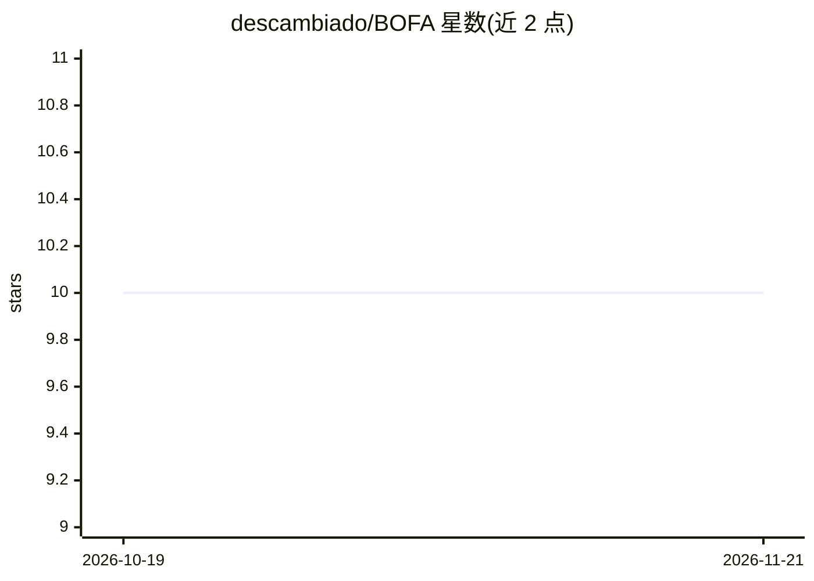

# descambiado/BOFA

⭐ 10 · Python · MIT · 推送 2026-10-31 · [GitHub](https://github.com/descambiado/BOFA) · 个人维护

**面向授权安全工作流的本地优先运行时，附去重与 AI 副驾**

BOFA 是用于授权安全工作流（漏洞赏金、授权渗透测试）的本地优先执行运行时：为每个项目维护工作区记忆，导入范围、公开报告、URL 列表、Burp sitemap 等数据，构建目标图谱，比对快照差异，输出新颖性评分、重复风险与人工复核队列，并将证据与运行历史绑定在同一工作流中。AI 部分定位为基于真实证据的副驾：支持 Ollama、LM Studio、vLLM 本地推理，远程模型需逐请求授权。接口覆盖 CLI、FastAPI 后端、React Web UI 与 MCP 服务器。项目自称 alpha 阶段，不含云端 provisioner，不自动提交 HackerOne 报告。

## 筛选速览

| 维度 | 判定 | 备注 |
|---|---|---|
| AI 角色 | `ai-enhanced` | 去掉 AI 部分产品仍成立 |
| 许可风险 | `permissive` | MIT |
| 部署形态 | `library` | 以包/库形式分发 |
| 模型依赖 | local-ok | 支持本地模型 |
| 硬件要求 | — | 无带数字的原话,不猜 |
| 安装摩擦 | `low` | 无编译、无系统依赖或容器化 |
| 成熟度 | `idea` | |

## 能力要点

- 快照差异检测、新颖性评分与重复风险聚类复核队列
- 支持 Ollama/LM Studio/vLLM 本地模型，远程调用需逐请求授权
- deny-by-default 执行架构：Ed25519 签名 JobSpec、持久化授权与运行收据
- CLI、FastAPI、Web UI、MCP 服务器与 run_skill 安全 agent 多接口

## 适用场景

- 漏洞赏金项目中避免提交重复报告，筛选新颖发现
- 授权渗透测试中保存证据与运行历史
- 本地安全实验环境学习与防御性验证

## 场景标签

`网络安全` `工作流自动化` · 领域:效率与自动化

## 证据(README 行号)

> L11: BOFA is an open execution fabric for **authorized security workflows, evidence and policy-gated AI copilots**.
> L74: BOFA is designed to support AI as a copilot over real evidence, not as a substitute for evidence.
> L78: - the LLM proposes actions, but deterministic policy controls execution

## 星数曲线

2026-10-19 10 → 2026-11-21 10（+0）

---
*卡片 v1 · prompt 1.4 · 生成 2026-11-19 · 置信度 high · 依据 README sha `4502b2e2240b` · [字段定义](../../DATASET.md)*
