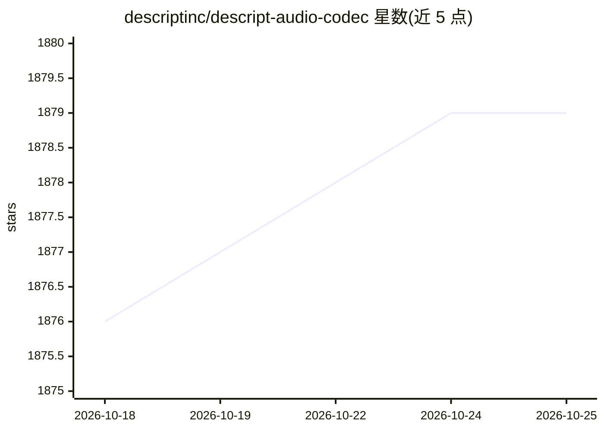

# descriptinc/descript-audio-codec

⭐ 1,879 · Python · MIT · 推送 2026-07-16 · [GitHub](https://github.com/descriptinc/descript-audio-codec) · [官网](https://descript.notion.site/Descript-Audio-Codec-11389fce0ce2419891d6591a68f814d5) · 组织维护

**神经音频编解码器：44.1kHz 音频压缩至 8kbps 离散码**

Descript 开源的通用神经音频编解码器（Improved RVQGAN），提供训练与推理脚本，可将 44.1kHz/24kHz/16kHz 单声道或立体声音频压缩为约 8kbps 的离散码（约 90 倍压缩），并从码本重建音频。模型权重以 MIT 许可在仓库发布，首次运行自动下载。提供 pip 安装、CLI（encode/decode）、Python API 与 Docker 镜像，支持单卡与多卡训练。作者称可在音频语言建模应用中作为 EnCodec 的直接替代。

## 筛选速览

| 维度 | 判定 | 备注 |
|---|---|---|
| AI 角色 | `ai-native` | 本体是模型或模型工具 |
| 许可风险 | `permissive` | MIT |
| 部署形态 | `self-host` | docker 或自建部署 |
| 模型依赖 | — | README 未给出锁定关系 |
| 硬件要求 | — | 无带数字的原话,不猜 |
| 安装摩擦 | `low` | 无编译、无系统依赖或容器化 |
| 成熟度 | — | 结构信号不足 |

## 能力要点

- 44.1kHz 音频压缩至 8kbps 离散码，约 90 倍压缩
- 权重以 MIT 许可发布，覆盖 16/24/44.1kHz 采样率
- 提供 CLI 编码/解码与 Python API，及 Docker 镜像
- 支持单 GPU 与多 GPU（torchrun）训练

## 适用场景

- 把音频压缩为离散码用于生成式音频建模
- 替代 EnCodec 用于 AudioLM/MusicGen 类应用的 token 化
- 复现或微调音频编解码器训练实验

## 场景标签

 · 领域:音频 AI/神经编解码

## 证据(README 行号)

> L3: This repository contains training and inference scripts
> L12: 👉 With Descript Audio Codec, you can compress **44.1 KHz audio** into discrete codes at a **low 8 kbps bitrate**.
> L15: 👌 It can be used as a drop-in replacement for EnCodec for all audio language modeling applications (such as AudioLM

## 星数曲线

2026-10-18 1,876 → 2026-10-25 1,879（+3）

---
*卡片 v1 · prompt 1.4 · 生成 2026-10-21 · 置信度 high · 依据 README sha `bc9292580363` · [字段定义](../../DATASET.md)*
