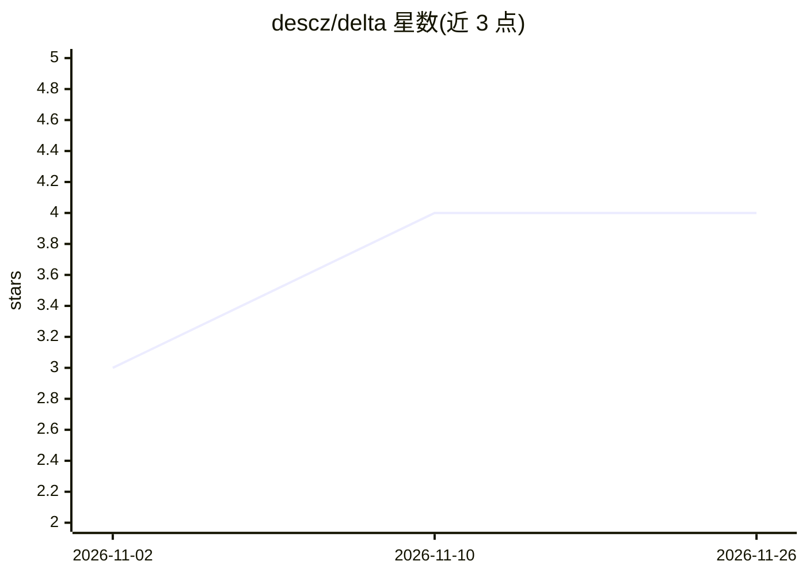

# descz/delta

⭐ 4 · C · NOASSERTION · 推送 2026-11-11 · [GitHub](https://github.com/descz/delta) · [官网](https://descz.github.io/delta/) · 个人维护 · 中文 README

**终端里的 C11 单文件编码 Agent：读码改码执行命令**

用纯 C11 编写的终端编码 Agent，编译为单一可执行文件，零运行时依赖（无 Node/Python/npm）。用户以自然语言让它读取代码、精确编辑文件、运行命令、处理 Git、下载网页，并支持 MCP（HTTP/stdio）、SKILL.md 内置技能、跨会话记忆与项目符号索引图。通过 models.dev 目录接入用户自选的模型提供商（/login 粘贴 API key），流式输出可中断。Windows 为参考平台（374 项端到端测试），Linux 已构建并测试，macOS 仅提供源码构建且未经测试。许可证为 source-available，禁止商用出售或克隆。

## 筛选速览

| 维度 | 判定 | 备注 |
|---|---|---|
| AI 角色 | `ai-native` | 本体是模型或模型工具 |
| 许可风险 | `none` | NOASSERTION |
| 部署形态 | `desktop` | 安装包/桌面程序 |
| 模型依赖 | — | README 未给出锁定关系 |
| 硬件要求 | — | 无带数字的原话,不猜 |
| 安装摩擦 | `medium` | 含编译或系统依赖之一 |
| 成熟度 | — | 结构信号不足 |

## 能力要点

- 单一 C11 可执行文件，零运行时依赖，Windows 829 KB / 约 1.7 MB 私有内存
- 40+ 工具操作：文件精确编辑、shell、Git checkpoint、web、MCP、memory、codegraph
- 10 个内置 SKILL.md 工作流与 hook/extension 扩展机制
- 逐 token 流式输出，对话中途发消息可立即切断回复

## 适用场景

- 在终端用自然语言完成读码、改码、跑命令的开发流程
- 改动前用 Git checkpoint 做安全快照并支持 /undo 撤销编辑
- 通过 MCP 或扩展/hook 定制 Agent 的工具与行为

## 场景标签

`编码 Agent` · 领域:编码与开发

## 证据(README 行号)

> L3:  A coding agent that does the work in your terminal
> L5:  Ask in your own words: read code, edit files, run commands, handle git, search the web .
> L23: A **single executable written in C11, with no dependencies at all**: no Node, Python, npm, pip or

## 星数曲线

2026-11-02 3 → 2026-11-26 4（+1）

---
*卡片 v1 · prompt 1.4 · 生成 2026-11-21 · 置信度 high · 依据 README sha `bfc303dd9c1a` · [字段定义](../../DATASET.md)*
