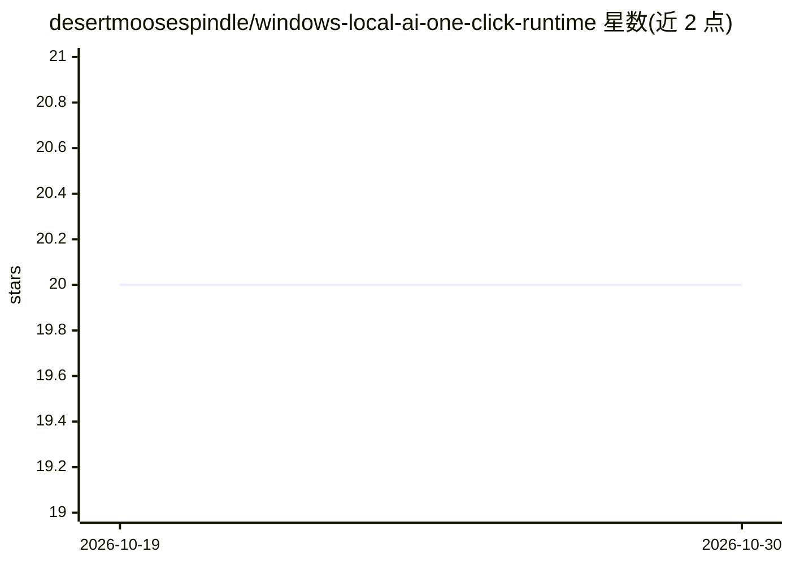

# desertmoosespindle/windows-local-ai-one-click-runtime

⭐ 20 · CSS · MIT · 推送 2026-10-19 · [GitHub](https://github.com/desertmoosespindle/windows-local-ai-one-click-runtime) · 个人维护

**Windows 本地 AI 一键安装/配置/恢复的工作流工具**

面向 Windows 用户的独立实用工具：以可执行文件形式组织本地 AI 的安装、运行时检查、配置与恢复工作流。机制包括选择/检测模型、运行时、GPU 或 API 上下文，分析当前配置，保存/应用预设 profile，验证后可回滚到已知良好配置；变更前先备份。以 GitHub Releases 的 ZIP 压缩包分发，解压后运行 exe。README 未披露具体的运行时绑定或下载内容细节，声明非 Ollama/NVIDIA/微软等官方工具，不含商业模型。

## 筛选速览

| 维度 | 判定 | 备注 |
|---|---|---|
| AI 角色 | `ai-ecosystem` | LLM/agent 周边工具 |
| 许可风险 | `permissive` | MIT |
| 部署形态 | `desktop` | 安装包/桌面程序 |
| 模型依赖 | — | README 未给出锁定关系 |
| 硬件要求 | — | 无带数字的原话,不猜 |
| 安装摩擦 | `low` | 无编译、无系统依赖或容器化 |
| 成熟度 | — | 结构信号不足 |

## 能力要点

- 一键本地 AI 安装工作流与前后状态检查
- 变更前备份的已知良好配置与恢复回滚流程
- 可复用的替代配置 profile 管理
- 以 GitHub Releases ZIP + exe 形式分发

## 适用场景

- 在 Windows 上组织本地 AI 运行时的安装与配置步骤
- 配置出错后回滚到之前的已知良好状态
- 管理多套本地 AI 替代配置 profile

## 场景标签

`工作流自动化` · 领域:效率与自动化

## 证据(README 行号)

> L19: **Windows Local AI One-Click Runtime** is designed to organize a Windows workflow around **one-click local AI setup
> L43: 1. **Select / Detect** — choose the relevant model, runtime, GPU, API, or storage context.

## 星数曲线

2026-10-19 20 → 2026-10-30 20（+0）

---
*卡片 v1 · prompt 1.4 · 生成 2026-10-28 · 置信度 mid · 依据 README sha `db3b73b37534` · [字段定义](../../DATASET.md)*
