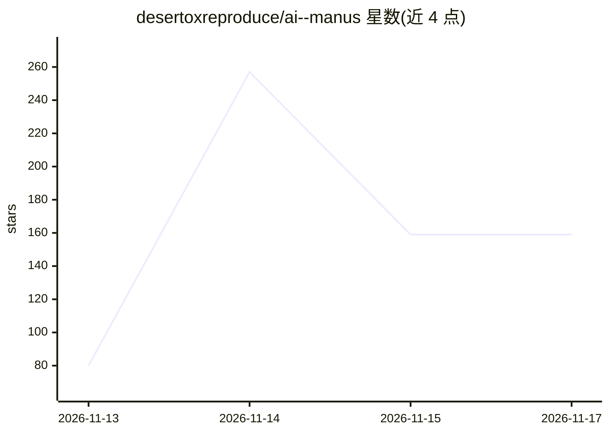

# desertoxreproduce/ai--manus

⭐ 159 · Apache-2.0 · 推送 2026-11-15 · [GitHub](https://github.com/desertoxreproduce/ai--manus) · 个人维护

**面向个人用户的自主 AI Agent：代跑代码与操控浏览器**

面向家庭、学习与轻办公场景的自主 AI 代理，核心能力为自主执行代码脚本与浏览器操控（导航网页、填表、采集信息），并可在后台作为个人助手运行多步骤任务，无需用户具备编程背景。README 声明其定位为小规模任务助手而非企业平台，跨会话可重复执行相同工作流。README 为功能介绍与下载引导页，未给出代码仓库结构、模型接入方式或具体安装命令，仅提供系统兼容性表（最低 4 GB 内存、双核 CPU）与使用步骤说明，工程细节无法从文档核验。

## 筛选速览

| 维度 | 判定 | 备注 |
|---|---|---|
| AI 角色 | `ai-native` | 本体是模型或模型工具 |
| 许可风险 | `permissive` | Apache-2.0 |
| 部署形态 | `None` |  |
| 模型依赖 | — | README 未给出锁定关系 |
| 硬件要求 | — | 无带数字的原话,不猜 |
| 安装摩擦 | `low` | 无编译、无系统依赖或容器化 |
| 成熟度 | — | 结构信号不足 |

## 能力要点

- 自主编写并执行脚本，完成多步骤任务
- 浏览器操控：导航网页、填写表单、采集信息
- 后台个人助手模式，跨会话重复执行工作流

## 适用场景

- 学习研究中整理资料、跑小型脚本
- 代替人工浏览多页面收集信息、填重复表单
- 家庭与轻办公场景的日常自动化杂务

## 场景标签

`AI 助手` `浏览器自动化` `工作流自动化` · 领域:效率与自动化

## 证据(README 行号)

> L18: Manus is an autonomous AI agent designed to run code and control a browser on your behalf. Instead of acting like a
> L22: Manus is not a heavy studio suite or a complex enterprise platform. It is a focused helper built for home, study, a

## 星数曲线

2026-11-13 80 → 2026-11-17 159（+79）

---
*卡片 v1 · prompt 1.4 · 生成 2026-11-17 · 置信度 low · 依据 README sha `a3d88e202bf0` · [字段定义](../../DATASET.md)*
