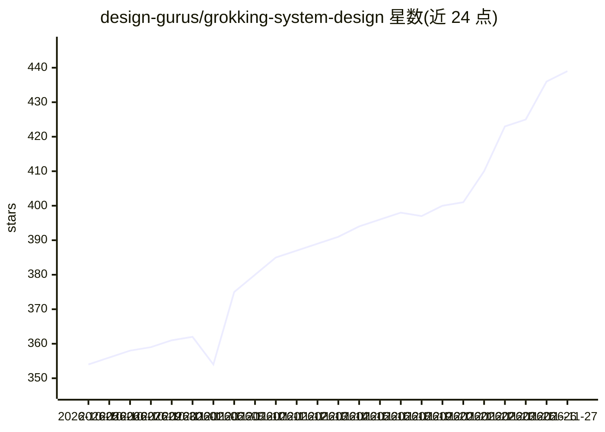

# design-gurus/grokking-system-design

⭐ 439 · CC-BY-4.0 · 推送 2026-11-22 · [GitHub](https://github.com/design-gurus/grokking-system-design) · [官网](https://www.designgurus.io/course/grokking-the-system-design-interview?utm_source=github&utm_medium=repo&utm_campaign=grokking-system-design&utm_content=repo-homepage) · 组织维护

**面向系统设计面试者的免费学习资料库**

DesignGurus.io 课程 Grokking the System Design Interview 的免费开源配套仓库，以 Markdown 组织：30 个设计模式、59 道设计题逐步走读、122 家公司面试指南、19 篇分布式系统深入解析、35 张速查表、8 条学习路线图与 146 张图。按 7 步面试框架组织答题流程，按读者时间与角色（明日面试/应届/管理层等）提供对应路线，另含词汇表与可下载的 PDF 速查表。

## 筛选速览

| 维度 | 判定 | 备注 |
|---|---|---|
| AI 角色 | `ai-knowledge` | 知识聚合/清单类 |
| 许可风险 | `viral` | CC-BY-4.0 |
| 部署形态 | `None` |  |
| 模型依赖 | — | README 未给出锁定关系 |
| 硬件要求 | — | 无带数字的原话,不猜 |
| 安装摩擦 | `low` | 无编译、无系统依赖或容器化 |
| 成熟度 | — | 结构信号不足 |

## 能力要点

- 30 个系统设计模式与 59 道题目走读（含 AI/LLM 系统类别）
- 按时间预算与角色提供 8 条学习路线图
- 122 家公司面试指南与 19 篇分布式系统案例深入解析
- 35 张速查表与可下载的离线 PDF

## 适用场景

- 按 1 天/1 周/6 周计划准备系统设计面试
- 按目标公司查阅其常考设计题与考察点
- 学习缓存、分片、一致性等设计构件后套用到任意设计题
- 准备 AI/ML 方向的系统设计轮次

## 场景标签

`教程课程` `精选清单` · 领域:学习与行业

## 证据(README 行号)

> L10: Most candidates prepare by memorizing answers to a list of questions, then meet a question that is not on the list.
> L12: **30 patterns · 59 questions · 122 company guides · 19 deep dives · 35 cheat sheets · 8 roadmaps · 146 diagrams**
> L90: RAG pipeline · semantic search · LLM inference platform · model evaluation pipeline · AI agent orchestration · GPU 

## 星数曲线

2026-10-25 354 → 2026-11-27 439（+85）

---
*卡片 v1 · prompt 1.4 · 生成 2026-11-25 · 置信度 high · 依据 README sha `f13f2011c088` · [字段定义](../../DATASET.md)*
