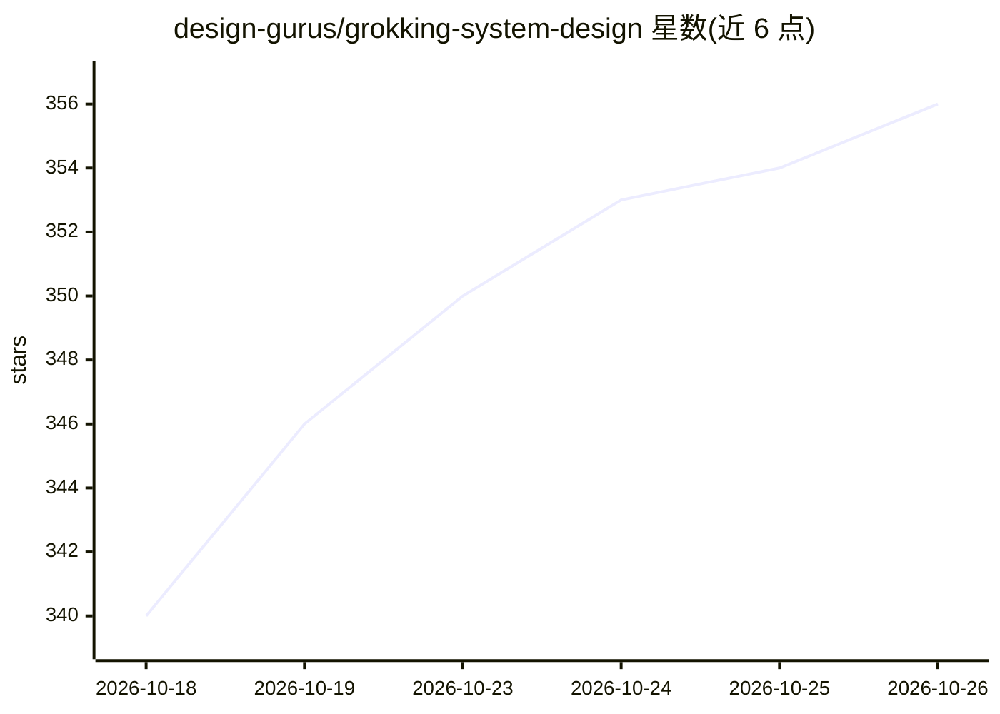

# design-gurus/grokking-system-design

⭐ 356 · CC-BY-4.0 · 推送 2026-10-19 · [GitHub](https://github.com/design-gurus/grokking-system-design) · [官网](https://www.designgurus.io/course/grokking-the-system-design-interview) · 组织维护

**面向系统设计面试的免费模式化学习知识库（30 模式/59 题）**

DesignGurus.io 维护的免费开源学习内容库，作为其付费课程 Grokking the System Design Interview 的配套：以缓存、分片、复制、一致性等 30 个可复用构建块为主线，配 59 道系统设计题解、122 家公司面试指南、19 篇分布式系统深读、27 张速查表和 4 条学习路线图，全部内容以 CC BY 4.0 许可在浏览器免费阅读。另含 AI/LLM 系统设计题类（RAG、推理平台等）与面向 AI 助手的 llms.txt 索引。内容为 Markdown，通过 PR 接受社区贡献。

## 筛选速览

| 维度 | 判定 | 备注 |
|---|---|---|
| AI 角色 | `ai-knowledge` | 知识聚合/清单类 |
| 许可风险 | `viral` | CC-BY-4.0 |
| 部署形态 | `None` |  |
| 模型依赖 | — | README 未给出锁定关系 |
| 硬件要求 | — | 无带数字的原话,不猜 |
| 安装摩擦 | `low` | 无编译、无系统依赖或容器化 |
| 成熟度 | — | 结构信号不足 |

## 能力要点

- 30 个系统设计模式 + 59 道题解 + 122 家公司面试指南
- 4 条按时间与资历分级的学习路线图（1 周冲刺到资深复习）
- 含 AI/LLM 系统设计题类（RAG、LLM 推理平台、GPU 调度等 8 题）
- llms.txt 格式索引全部 262 个页面，供 AI 助手读取

## 适用场景

- 按模式而非背题准备系统设计面试
- 面试前查阅目标公司的面试题型与考察点
- 查阅 SQL vs NoSQL、Kafka 对比等技术选型速查表

## 场景标签

`教程课程` · 领域:学习与行业

## 证据(README 行号)

> L3: > The free, open companion to the original **Grokking the System Design Interview** course by DesignGurus.io, create
> L10: Most candidates prepare by memorizing answers to a list of questions, then meet a question that is not on the list.
> L12: **30 patterns · 59 questions · 122 company guides · 19 deep dives · 27 cheat sheets · 4 roadmaps · 134 diagrams**

## 星数曲线

2026-10-18 340 → 2026-10-26 356（+16）

---
*卡片 v1 · prompt 1.4 · 生成 2026-10-22 · 置信度 high · 依据 README sha `6f6b6e413733` · [字段定义](../../DATASET.md)*
