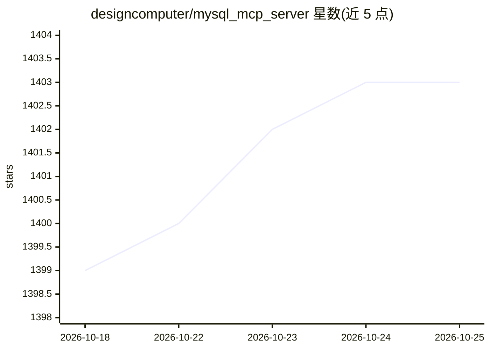

# designcomputer/mysql_mcp_server

⭐ 1,402 · Python · MIT · 推送 2026-08-02 · [GitHub](https://github.com/designcomputer/mysql_mcp_server) · [官网](https://designcomputer.com) · 个人维护

**让 AI 应用安全访问 MySQL 的 MCP 服务器**

基于 Model Context Protocol 的 MySQL 数据库服务器组件，供 Claude Desktop、Claude Code、VS Code 等 AI 客户端通过受控接口连接 MySQL。提供 execute_sql、get_schema_info、get_table_sample 三个工具及 explore_database、analyze_table 两个 MCP 提示词工作流；支持 STDIO 与 SSE/HTTP 传输、SSH 隧道、SSL/TLS、多数据库模式与表数据采样。限制：仅支持单条 SQL 语句；SSE 传输自身无鉴权，需反向代理保护。以 pip 包、Smithery、Claude Code/Autohand CLI 注册等方式安装。

## 筛选速览

| 维度 | 判定 | 备注 |
|---|---|---|
| AI 角色 | `ai-ecosystem` | LLM/agent 周边工具 |
| 许可风险 | `permissive` | MIT |
| 部署形态 | `library` | 以包/库形式分发 |
| 模型依赖 | locked-api |  |
| 硬件要求 | — | 无带数字的原话,不猜 |
| 安装摩擦 | `low` | 无编译、无系统依赖或容器化 |
| 成熟度 | — | 结构信号不足 |

## 能力要点

- execute_sql / get_schema_info / get_table_sample 三个 MCP 工具
- 标识符白名单校验防 SQL 注入，日志自动掩码密码与 SSH 私钥
- 支持 STDIO 与 SSE/HTTP 传输、SSH 隧道与 SSL/TLS
- 多数据库模式可用 database.table 跨库查询

## 适用场景

- 在 Claude Desktop / Claude Code 中查询和分析 MySQL 数据
- 让 AI 按引导工作流系统探索数据库结构
- 远程部署时经 SSE 传输接入自托管环境

## 场景标签

`数据分析` · 领域:效率与自动化

## 证据(README 行号)

> L5: A Model Context Protocol (MCP) implementation that enables secure interaction with MySQL databases. This server comp
> L149: The MySQL MCP Server is designed to be integrated with AI applications like Claude Desktop and should not be run d

## 星数曲线

2026-10-18 1,399 → 2026-10-25 1,403（+4）

---
*卡片 v1 · prompt 1.4 · 生成 2026-10-21 · 置信度 mid · 依据 README sha `aec5dacca3fb` · [字段定义](../../DATASET.md)*
