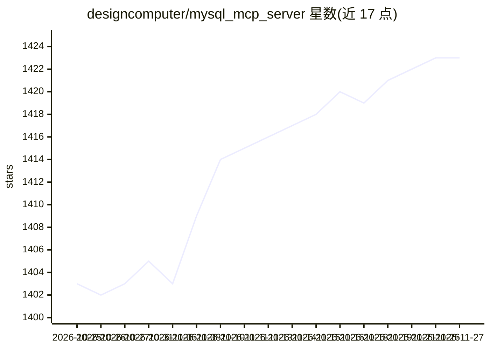

# designcomputer/mysql_mcp_server

⭐ 1,423 · Python · MIT · 推送 2026-10-28 · [GitHub](https://github.com/designcomputer/mysql_mcp_server) · [官网](https://designcomputer.com) · 个人维护

**让 AI 应用通过 MCP 安全访问 MySQL 数据库的服务器**

实现 Model Context Protocol 的 MySQL 服务器组件，在 AI 应用（宿主/客户端）与 MySQL 数据库之间提供受控接口。提供列出表资源、读取表内容、执行 SQL（SELECT/SHOW/DESCRIBE 及带破坏性标记的 DML）、获取 schema 元数据与数据采样等工具，并暴露 explore_database/analyze_table 两个 MCP prompts。支持 STDIO 与 SSE/HTTP 传输、SSH 隧道、多数据库模式，通过环境变量配置连接，名称校验白名单防止 SQL 注入，日志自动掩码密码。仅支持单条 SQL 语句，SSE 模式无内置认证需自行加代理。

## 筛选速览

| 维度 | 判定 | 备注 |
|---|---|---|
| AI 角色 | `ai-ecosystem` | LLM/agent 周边工具 |
| 许可风险 | `permissive` | MIT |
| 部署形态 | `library` | 以包/库形式分发 |
| 模型依赖 | — | README 未给出锁定关系 |
| 硬件要求 | — | 无带数字的原话,不猜 |
| 安装摩擦 | `low` | 无编译、无系统依赖或容器化 |
| 成熟度 | — | 结构信号不足 |

## 能力要点

- 提供 execute_sql、get_schema_info、get_table_sample 三个 MCP 工具
- 支持 STDIO 与 Streamable HTTP (SSE) 两种传输模式
- SSH 隧道与 SSL/TLS 加密连接，日志自动掩码敏感信息
- 标识符白名单校验与 DML 破坏性提示

## 适用场景

- 在 Claude Desktop/Claude Code 中探索和分析 MySQL 数据库
- 让 AI 客户端以受控方式执行 SQL 查询与读取表结构
- 通过 SSE 模式远程部署数据库访问服务

## 场景标签

`数据分析` · 领域:效率与自动化

## 证据(README 行号)

> L5: A Model Context Protocol (MCP) implementation that enables secure interaction with MySQL databases. This server comp
> L7: > **Note**: MySQL MCP Server supports both standard input/output (STDIO) and Streamable HTTP (SSE) transport modes. 
> L143: The MySQL MCP Server is designed to be integrated with AI applications like Claude Desktop and should not be run d

## 星数曲线

2026-10-25 1,403 → 2026-11-27 1,423（+20）

---
*卡片 v1 · prompt 1.4 · 生成 2026-11-24 · 置信度 high · 依据 README sha `f44808fb9e4e` · [字段定义](../../DATASET.md)*
