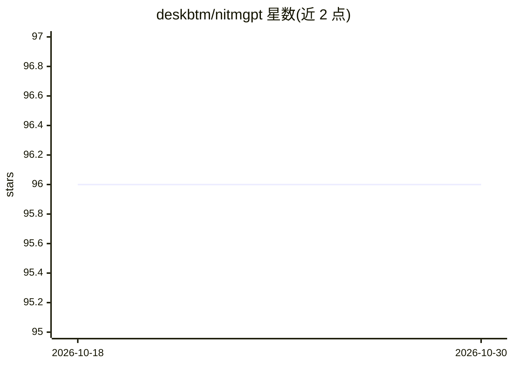

# deskbtm/nitmgpt

⭐ 96 · Dart · NOASSERTION · 推送 2026-07-15 · [GitHub](https://github.com/deskbtm/nitmgpt) · 个人维护

**用 GPT 过滤 Android 广告/垃圾通知的监听客户端**

Android 通知监听客户端，读取系统通知并调用 GPT3 判断是否为广告或垃圾通知，自动隐藏之；用户需自行配置 OpenAI API Key，付费 API 用户可通过 Custom rules 忽略指定应用以控制调用量与隐私。附带本地历史导出（xlsx）、常驻后台服务与自定义匹配规则。通过 GitHub Release 分发安装包，仅在模拟器上测试过；项目已因隐私问题归档，AGPL-3.0 许可。

## 筛选速览

| 维度 | 判定 | 备注 |
|---|---|---|
| AI 角色 | `ai-native` | 本体是模型或模型工具 |
| 许可风险 | `none` | NOASSERTION |
| 部署形态 | `None` |  |
| 模型依赖 | — | README 未给出锁定关系 |
| 硬件要求 | — | 无带数字的原话,不猜 |
| 安装摩擦 | `low` | 无编译、无系统依赖或容器化 |
| 成熟度 | `idea` | |

## 能力要点

- 基于 GPT3 的通知内容过滤与自动隐藏
- Custom rules 忽略指定应用，控制 API 调用与隐私
- 本地导出通知历史（xlsx）
- Material You 界面，AGPL-3.0 开源

## 适用场景

- 自动屏蔽手机上的广告与垃圾推送
- 通过自定义规则排除聊天等隐私应用的通知过滤
- 导出通知历史记录进行查看

## 场景标签

 · 领域:移动应用/通知管理

## 证据(README 行号)

> L18: **Hate these ads or spam notifications?** Hurry up and use NITM now! It's a watcher client for Android that auto-hi
> L24: - Innovative notification filtering power by GPT3.

## 星数曲线

2026-10-18 96 → 2026-10-30 96（+0）

---
*卡片 v1 · prompt 1.4 · 生成 2026-10-23 · 置信度 high · 依据 README sha `53f2ba9ab284` · [字段定义](../../DATASET.md)*
