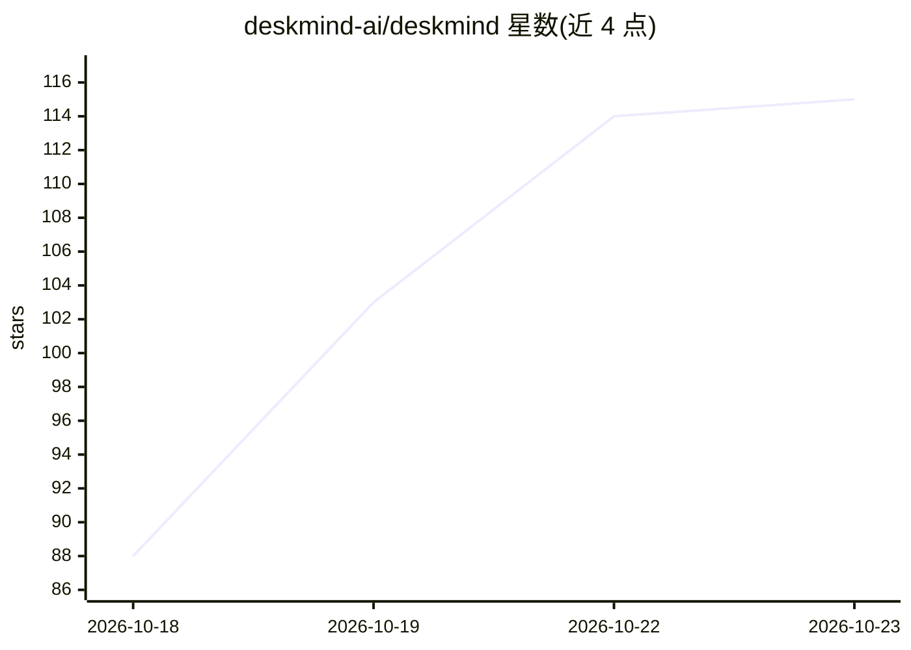

# deskmind-ai/deskmind

⭐ 115 · Swift · Apache-2.0 · 推送 2026-10-22 · [GitHub](https://github.com/deskmind-ai/deskmind) · [官网](https://deskmind.dev) · 组织维护 · 中文 README

**macOS 本地计算机使用 agent：读屏、决策、操作**

面向 macOS 用户的开源 computer use agent：读取屏幕、以多选题形式决策下一步并执行操作，歧义任务会向用户提问而非猜测。核心为本地 MLX 小模型：0.8B 路由决策，不确定步骤升级到 4B，无云端调用。组件含 Eyes（视觉定位 4B）、Brain（决策）、Hands（macOS 操作）、Mac 应用与 Bench 评测。要求 macOS 15+、Apple Silicon，模型下载约 5.3 GB。自称仍不擅长长表格复制、凭小票填表等任务。

## 筛选速览

| 维度 | 判定 | 备注 |
|---|---|---|
| AI 角色 | `ai-native` | 本体是模型或模型工具 |
| 许可风险 | `permissive` | Apache-2.0 |
| 部署形态 | `None` |  |
| 模型依赖 | — | README 未给出锁定关系 |
| 硬件要求 | — | 无带数字的原话,不猜 |
| 安装摩擦 | `low` | 无编译、无系统依赖或容器化 |
| 成熟度 | — | 结构信号不足 |

## 能力要点

- 0.8B→4B 本地路由：每步为多选题打分，低置信度升级或交用户
- 读屏-决策-操作全链路开源，含 Bench 评测（39/39 通过，样本 13 任务）
- macOS 15+ / Apple Silicon 原生应用，签名公证，首次运行下载约 5.3 GB 模型
- 默认本地推理，决策一步无需网络；云模型为可选配置

## 适用场景

- 在 Mac 上让 agent 代为完成桌面操作任务
- 歧义场景下由 agent 提问确认后继续执行
- 研究小模型本地驱动的 GUI agent 与路由机制

## 场景标签

`GUI 自动化` · 领域:效率与自动化

## 证据(README 行号)

> L7: Open-source computer use for your Mac. DeskMind reads the screen, works out the next step and acts, all with small m
> L19: **A small model, on your Mac.** A 0.8B model decides each step and hands the unsure ones to a 4B. Both run on your 
> L61: |Brain|decides the next step|0.8B and 4B, MLX, 0.8B → 4B routing, `/v1/systemone`|

## 星数曲线

2026-10-18 88 → 2026-10-23 115（+27）

---
*卡片 v1 · prompt 1.4 · 生成 2026-10-23 · 置信度 high · 依据 README sha `04ec013f92d2` · [字段定义](../../DATASET.md)*
