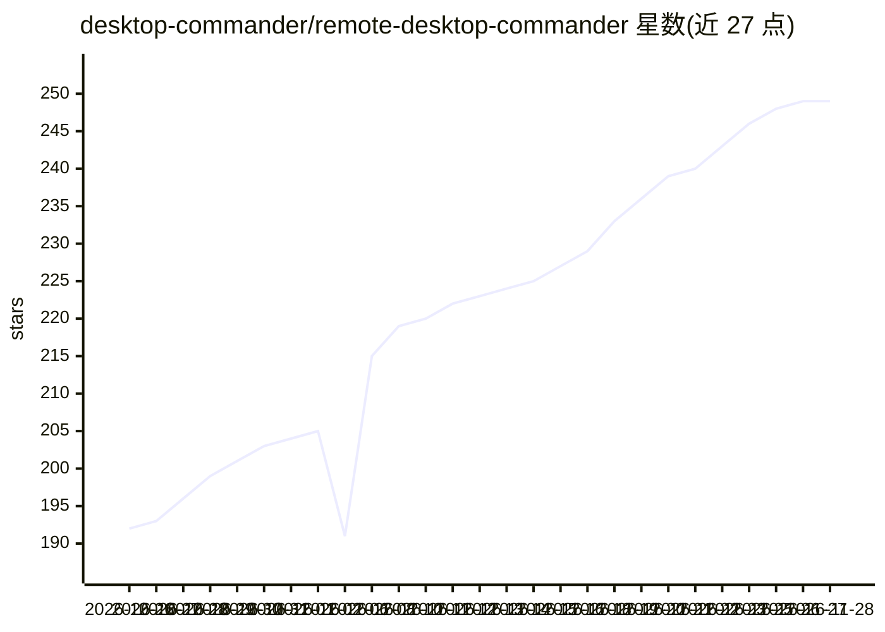

# desktop-commander/remote-desktop-commander

⭐ 249 · NOASSERTION · 推送 2026-11-27 · [GitHub](https://github.com/desktop-commander/remote-desktop-commander) · [官网](https://mcp.desktopcommander.app) · 组织维护

**让 AI 客户端经 MCP 远程访问本机文件与终端的托管服务**

Desktop Commander 的远程 MCP 托管服务器：本机运行设备代理后，claude.ai、ChatGPT、Cursor、VS Code、Gemini CLI 等支持远程 MCP 连接器的 AI 应用可通过 OAuth 2.0 连接，获得对该机器文件系统与终端的读写、搜索、进程管理等约 30 个工具。本仓库只承载配置清单、文档与 issue 跟踪，服务实现不开源（专有）；开源本地 stdio 版本为 DesktopCommanderMCP。要求各受控机器安装 Node.js 18+ 并保持代理运行，支持 macOS/Windows/Linux。

## 筛选速览

| 维度 | 判定 | 备注 |
|---|---|---|
| AI 角色 | `ai-ecosystem` | LLM/agent 周边工具 |
| 许可风险 | `none` | NOASSERTION |
| 部署形态 | `library` | 以包/库形式分发 |
| 模型依赖 | — | README 未给出锁定关系 |
| 硬件要求 | — | 无带数字的原话,不猜 |
| 安装摩擦 | `low` | 无编译、无系统依赖或容器化 |
| 成熟度 | `idea` | |

## 能力要点

- OAuth 2.0 + PKCE 与设备授权流配对，设备可在仪表盘撤销
- 工具覆盖文件读写、搜索、终端进程、多设备管理
- 提供 Cursor/VS Code/Gemini CLI/Antigravity 等客户端接入方式
- 代理停止即访问终止，工具以用户账户权限执行

## 适用场景

- 外出时让 AI 助手远程操作家中或公司电脑的文件与终端
- 在 claude.ai 对话中直接读写本机 Word/Excel/PDF 文件
- 通过一句话让 AI 在本机创建并运行 Python 脚本
- 一台对话里同时管理多台已配对电脑

## 场景标签

 · 领域:AI 基础设施/MCP

## 证据(README 行号)

> L7: Reach your computer's filesystem and terminal from any AI app that supports remote MCP connectors. Remote Desktop Co
> L16: > This repository hosts the public manifests, documentation and issue tracker for the hosted service. The service i

## 星数曲线

2026-10-26 192 → 2026-11-28 249（+57）

---
*卡片 v1 · prompt 1.4 · 生成 2026-11-25 · 置信度 high · 依据 README sha `5eeb08bb9789` · [字段定义](../../DATASET.md)*
