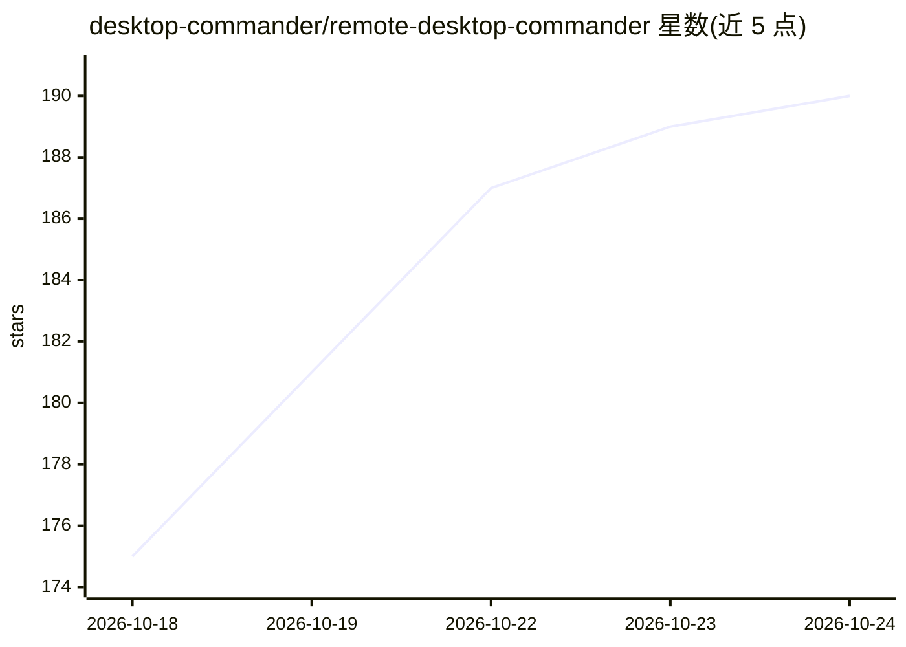

# desktop-commander/remote-desktop-commander

⭐ 190 · NOASSERTION · 推送 2026-10-22 · [GitHub](https://github.com/desktop-commander/remote-desktop-commander) · [官网](https://mcp.desktopcommander.app) · 组织维护

**远程 MCP 服务器：让 AI 应用经 OAuth 控制你的电脑**

Desktop Commander 的官方远程 MCP 服务器（托管服务，非开源），通过 mcp.desktopcommander.app 以 Streamable HTTP + OAuth 2.0 转发到本机运行的设备代理，使 claude.ai、ChatGPT、Cursor、Claude Code、VS Code、Gemini CLI 等 AI 客户端获得与本地服务器相同的文件与终端访问能力。提供约 30 个工具覆盖文件读写编辑、搜索、进程管理与多设备配对。仓库仅承载文档、清单与问题跟踪；服务实现为专有软件，当前处于 beta 阶段。

## 筛选速览

| 维度 | 判定 | 备注 |
|---|---|---|
| AI 角色 | `ai-ecosystem` | LLM/agent 周边工具 |
| 许可风险 | `none` | NOASSERTION |
| 部署形态 | `library` | 以包/库形式分发 |
| 模型依赖 | locked-api |  |
| 硬件要求 | — | 无带数字的原话,不猜 |
| 安装摩擦 | `low` | 无编译、无系统依赖或容器化 |
| 成熟度 | `idea` | |

## 能力要点

- OAuth 2.0 + PKCE 与设备配对码流程，控制端仅在设备代理运行时可达
- 工具覆盖文件读写/编辑、搜索、终端进程、多设备管理与配置
- 一键接入 Claude、ChatGPT、Cursor、VS Code、Gemini CLI 等客户端

## 适用场景

- 从 claude.ai 或 ChatGPT 网页端远程操作家中/办公室电脑的终端与文件
- 在一个对话中按名称控制多台已配对机器
- 远程搭建开发环境并运行脚本

## 场景标签

 · 领域:AI 基础设施/MCP 工具

## 证据(README 行号)

> L7: Reach your computer's filesystem and terminal from any AI app that supports remote MCP connectors. Remote Desktop Co
> L16: > This repository hosts the public manifests, documentation and issue tracker for the hosted service. The service i

## 星数曲线

2026-10-18 175 → 2026-10-24 190（+15）

---
*卡片 v1 · prompt 1.4 · 生成 2026-10-22 · 置信度 high · 依据 README sha `7c34ad5cbd82` · [字段定义](../../DATASET.md)*
