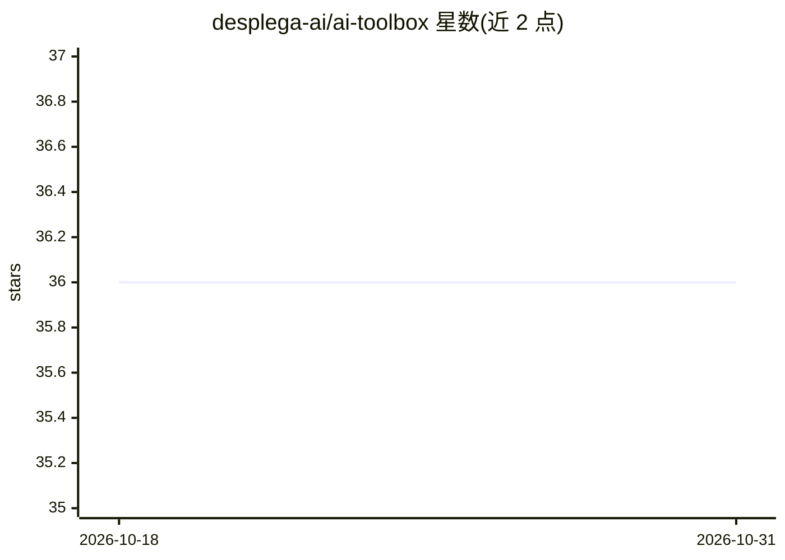

# desplega-ai/ai-toolbox

⭐ 36 · TypeScript · 推送 2026-10-28 · [GitHub](https://github.com/desplega-ai/ai-toolbox) · [官网](https://desplega.ai) · 组织维护

**面向 Claude Code 的 AI 开发工具与插件 monorepo（17 个子工具）**

desplega.ai 维护的 monorepo，收录 17 个独立子工具，围绕 Claude Code 使用场景：会话通知、菜单栏成本追踪、用量与成本分析 CLI、AI 与人工代码贡献统计、多 agent 协调插件、Git worktree 管理等；另有与 AI 关联较弱的知识管理、发票抓取、截图服务等通用工具。插件通过 Claude Code 的 marketplace 命令安装（desplega/agent-swarm/wts/brain/file-review/remarkable），Python 工具用 uvx、TypeScript 工具用 npm 全局安装。各工具独立维护，需查看各自 README 了解具体配置。

## 筛选速览

| 维度 | 判定 | 备注 |
|---|---|---|
| AI 角色 | `ai-ecosystem` | LLM/agent 周边工具 |
| 许可风险 | `none` | — |
| 部署形态 | `library` | 以包/库形式分发 |
| 模型依赖 | — | README 未给出锁定关系 |
| 硬件要求 | — | 无带数字的原话,不猜 |
| 安装摩擦 | `low` | 无编译、无系统依赖或容器化 |
| 成熟度 | — | 结构信号不足 |

## 能力要点

- 17 个独立子工具，覆盖 Claude Code 的用量分析、成本追踪、会话通知等
- 6 个可通过 Claude Code plugin marketplace 安装的插件（含多 agent 协调、Git worktree 管理）
- ai-tracker 追踪 AI 与人工代码贡献占比（Python/SQLite）
- cc-what 提供 Claude Code 用量与按模型成本统计的 CLI/SDK

## 适用场景

- 统计分析 Claude Code 的使用量与 token 成本
- 为 Claude Code 安装研究/规划/实现等工作流插件
- 追踪代码库中 AI 与人工贡献的比例

## 场景标签

`多智能体` `编码 Agent` `LLM 可观测性` · 领域:Agent 开发

## 证据(README 行号)

> L3: Monorepo of AI and developer tools by desplega.ai. Each subdirectory is a standalone tool with its own README.
> L9: |ai-tracker|Track AI vs human code contributions|Python, uv, SQLite|
> L37: ### Installation

## 星数曲线

2026-10-18 36 → 2026-10-31 36（+0）

---
*卡片 v1 · prompt 1.4 · 生成 2026-10-25 · 置信度 high · 依据 README sha `21fe0eafa5a1` · [字段定义](../../DATASET.md)*
