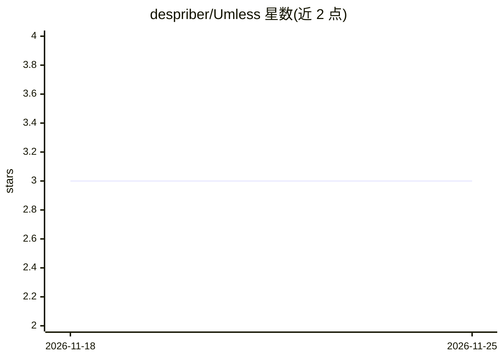

# despriber/Umless

⭐ 3 · Python · MIT · 推送 2026-11-02 · [GitHub](https://github.com/despriber/Umless) · 个人维护 · 中文 README

**帮用户改掉口头禅的本地语音输入工具，Windows+Android**

按住热键说话，本机运行 SenseVoice-Small（sherpa-onnx）识别，再经用户自配的 OpenAI 兼容大模型接口润色后写入光标处。除输入外，还把逐字稿存入本机 SQLite，用本地规则计算流畅度、简洁度评分，由大模型给出逻辑性、清晰度评分，生成每日表达诊断、习惯卡与每天 5 道口语练习题。桌面端为 Windows（安装包/便携版/源码），Android 端基于 fcitx5-android 提供 arm64 测试版输入法。MIT 许可，Android 端 LGPL-2.1，无遥测。

## 筛选速览

| 维度 | 判定 | 备注 |
|---|---|---|
| AI 角色 | `ai-native` | 本体是模型或模型工具 |
| 许可风险 | `permissive` | MIT |
| 部署形态 | `desktop` | 安装包/桌面程序 |
| 模型依赖 | local-ok | 支持本地模型 |
| 硬件要求 | — | 无带数字的原话,不猜 |
| 安装摩擦 | `low` | 无编译、无系统依赖或容器化 |
| 成熟度 | — | 结构信号不足 |

## 能力要点

- 本机识别（SenseVoice-Small，CPU 即可）+ OpenAI 兼容接口润色
- 口癖/重复/改口统计、每日表达诊断与习惯卡
- 按前台应用切换润色风格，三档润色强度
- 桌面端与 Android 端靠共享 spec 与黄金样例保证结果一致

## 适用场景

- 在日常语音输入的同时统计并改掉自己的口头禅
- 会议、聊天等不同应用场景使用不同的润色强度
- 在 Android 上用带语音输入和表达教练的中文输入法

## 场景标签

`语音识别` `AI 写作` · 领域:内容生成

## 证据(README 行号)

> L12:  按住说话，松开就是干净的文字；用得越久，你说话本身也越干净。
> L17: Umless 多做了一件事：**把你说的原话留在本机，算出口癖、重复、改口，每天给你一份表达诊断，用习惯卡和口语练习帮你把它们真正改掉。**
> L37: - **本机识别。** 默认 SenseVoice-Small（sherpa-onnx，CPU 即可，仓库内测试 RTF 约 0.04）；也可以换成更准、带标点的 Qwen3-ASR，或云端接口。

## 星数曲线

2026-11-18 3 → 2026-11-25 3（+0）

---
*卡片 v1 · prompt 1.4 · 生成 2026-11-22 · 置信度 high · 依据 README sha `d0fb1f8a9292` · [字段定义](../../DATASET.md)*
