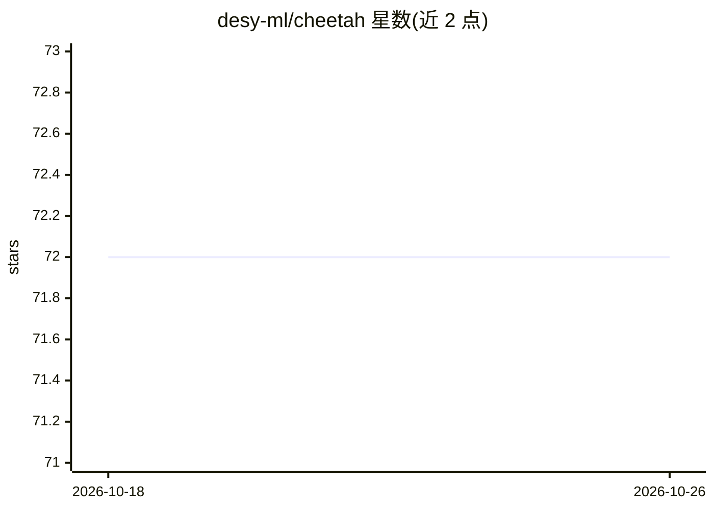

# desy-ml/cheetah

⭐ 72 · Python · GPL-3.0 · 推送 2026-10-22 · [GitHub](https://github.com/desy-ml/cheetah) · [官网](https://cheetah-accelerator.readthedocs.io) · 组织维护

**加速器光学的高性能可微分仿真库，服务强化学习与优化**

Cheetah 是基于 PyTorch 的可微分束流动力学仿真 Python 库，面向粒子加速器的机器学习应用。提供 Segment 表示加速器 lattice，支持从 LatticeJSON/Ocelot 加载，含 ParticleBeam（高保真多宏粒子追踪）与 ParameterBeam（省算力参数追踪）两种束流类，并可读取 openPMD/Astra/Ocelot 束流。可微分性支持基于梯度的磁铁设置优化、系统辨识与贝叶斯优化先验；速度上适合为强化学习快速生成数据。由 DESY、KIT 等多家机构联合开发。

## 筛选速览

| 维度 | 判定 | 备注 |
|---|---|---|
| AI 角色 | `ai-ecosystem` | LLM/agent 周边工具 |
| 许可风险 | `viral` | GPL-3.0 |
| 部署形态 | `library` | 以包/库形式分发 |
| 模型依赖 | — | README 未给出锁定关系 |
| 硬件要求 | — | 无带数字的原话,不猜 |
| 安装摩擦 | `low` | 无编译、无系统依赖或容器化 |
| 成熟度 | — | 结构信号不足 |

## 能力要点

- 基于 PyTorch 自动微分的加速器 lattice 仿真，支持梯度优化
- ParticleBeam/ParameterBeam 两种束流类，兼顾保真与算力
- 支持 LatticeJSON/Ocelot lattice 与 openPMD/Astra/Ocelot 束流导入
- 可选 3D 可视化与网格导出（glb）

## 适用场景

- 为强化学习算法快速生成加速器仿真训练数据
- 基于梯度优化加速器磁铁设置参数
- 物理模型与神经网络束流动力学模型的耦合建模

## 场景标签

 · 领域:科学计算/粒子加速器

## 证据(README 行号)

> L11: Cheetah is a high-speed differentiable beam dynamics code specifically designed to support machine learning applica
> L13: Its speed helps generate data fast, for example for extremely data-hungry reinforcement learning algorithms, while 

## 星数曲线

2026-10-18 72 → 2026-10-26 72（+0）

---
*卡片 v1 · prompt 1.4 · 生成 2026-10-24 · 置信度 high · 依据 README sha `78007c54080f` · [字段定义](../../DATASET.md)*
