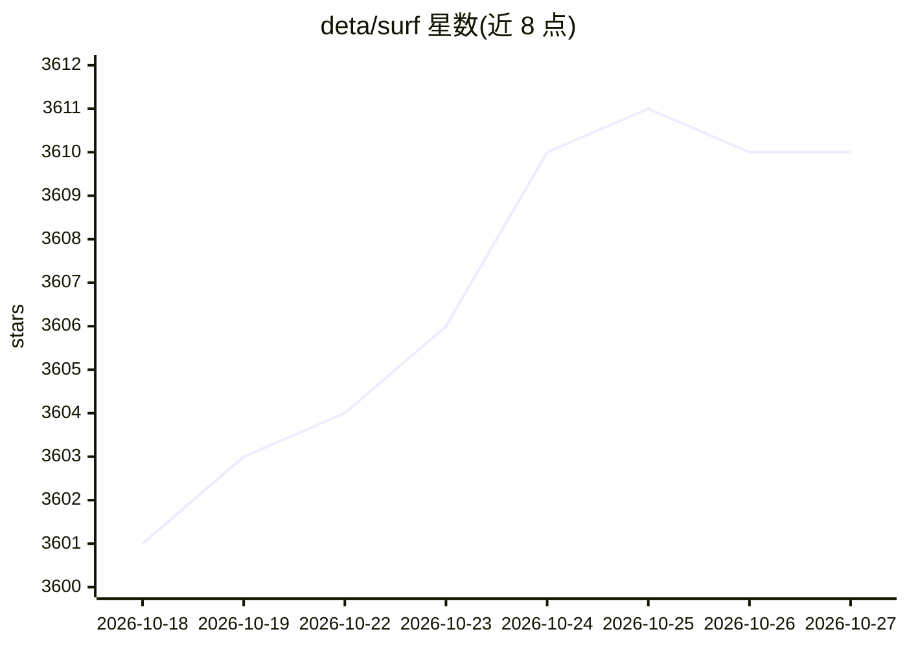

# deta/surf

⭐ 3,610 · TypeScript · Apache-2.0 · 推送 2026-08-24 · [GitHub](https://github.com/deta/surf) · [官网](https://deta.surf) · 组织维护

**本地优先的个人 AI 笔记本：整理文件网页并生成笔记**

桌面端 AI 笔记本应用，用 Svelte/TypeScript/Rust 构建，运行于 macOS、Windows 与 Linux。将本地文件、网页（YouTube、推文等）、PDF 等媒体存入基于 SFFS 本地存储引擎的私有媒体库并组织为笔记本；笔记中可 @-引用资源、触发网页搜索、生成带来源深链的引用；支持 Surflets 无代码生成交互式小应用。AI 部分由用户自选的大语言模型驱动：自带 API key、接入云模型或使用本地模型；数据本地存储于开放格式。

## 筛选速览

| 维度 | 判定 | 备注 |
|---|---|---|
| AI 角色 | `ai-native` | 本体是模型或模型工具 |
| 许可风险 | `permissive` | Apache-2.0 |
| 部署形态 | `None` |  |
| 模型依赖 | — | README 未给出锁定关系 |
| 硬件要求 | — | 无带数字的原话,不猜 |
| 安装摩擦 | `low` | 无编译、无系统依赖或容器化 |
| 成熟度 | — | 结构信号不足 |

## 能力要点

- SFFS 本地存储引擎，数据以开放透明格式存储在本地
- 笔记支持 @-引用任意资源、网页搜索并集成来源深链引用
- Surflets 无代码生成交互式应用
- 模型开放选择：自带 key / 云模型 / 本地语言模型

## 适用场景

- 跨 PDF、网页、视频等多种媒体做研究与综合笔记
- 在本地私有库中管理文件并离线使用
- 让 AI 基于自己资料回答问题并附可溯源引用

## 场景标签

`知识库管理` `文档问答` · 领域:知识与检索

## 证据(README 行号)

> L7: Deta Surf is an AI notebook that brings all your files and the web directly into your stream of thought.
> L88: Surf’s notes and Surflets are powered by large language models of your choice.
> L92: - Use Local Language Models

## 星数曲线

2026-10-18 3,601 → 2026-10-27 3,610（+9）

---
*卡片 v1 · prompt 1.4 · 生成 2026-10-21 · 置信度 mid · 依据 README sha `51238747488c` · [字段定义](../../DATASET.md)*
