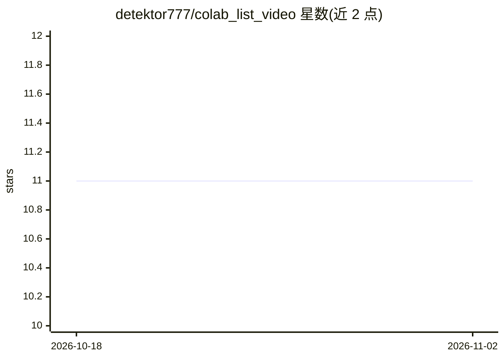

# detektor777/colab_list_video

⭐ 11 · Jupyter Notebook · 推送 2026-07-18 · [GitHub](https://github.com/detektor777/colab_list_video) · 个人维护

**视频 AI 处理的 Google Colab 笔记本链接清单**

收集视频处理类 AI 模型的 Google Colab 笔记本入口：涵盖 Real-ESRGAN 视频超分辨率、NAFNet 去模糊、FLAVR 与 DAIN 帧插值、InstColorization 上色共 5 个条目，每个条目附模型名与对应 .ipynb 的 Colab 打开链接。本身不含代码或安装命令，用户通过链接跳转到 Colab 环境在线运行各模型，属于跳转式导航清单。

## 筛选速览

| 维度 | 判定 | 备注 |
|---|---|---|
| AI 角色 | `ai-knowledge` | 知识聚合/清单类 |
| 许可风险 | `none` | — |
| 部署形态 | `None` |  |
| 模型依赖 | — | README 未给出锁定关系 |
| 硬件要求 | — | 无带数字的原话,不猜 |
| 安装摩擦 | `low` | 无编译、无系统依赖或容器化 |
| 成熟度 | — | 结构信号不足 |

## 能力要点

- 收录 5 个视频 AI 处理任务的 Colab 笔记本链接
- 覆盖超分、去模糊、帧插值、上色四类任务
- 每个条目直接给出对应 .ipynb 的 Colab 入口

## 适用场景

- 在 Colab 上运行 Real-ESRGAN 给视频超分辨率
- 用 DAIN/FLAVR 给视频补帧提高帧率
- 为黑白视频上色或去模糊

## 场景标签

`图像视频处理` `精选清单` · 领域:学习与行业

## 证据(README 行号)

> L1: # Upscale video (Real-ESRGAN)
> L7: # Deblur video (NAFNet)
> L13: # Interpolate video (FLAVR)
> L19: # Interpolate video (DAIN)
> L25: # Сolorization video (InstColorization)

## 星数曲线

2026-10-18 11 → 2026-11-02 11（+0）

---
*卡片 v1 · prompt 1.4 · 生成 2026-11-02 · 置信度 high · 依据 README sha `8ce4f9a4a26d` · [字段定义](../../DATASET.md)*
