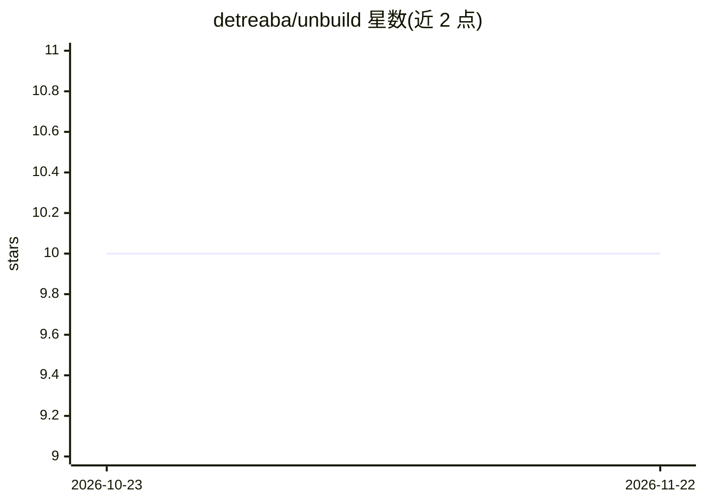

# detreaba/unbuild

⭐ 10 · TypeScript · 推送 2026-04-08 · [GitHub](https://github.com/detreaba/unbuild) · [官网](https://unbuild.tech) · 个人维护

**反向工程任意产品，为 AI 编码工具生成实施蓝图与配置**

输入 GitHub 仓库、网站 URL、产品页、API 规范或纯文本描述，经 Playwright 真实浏览器渲染、证据链验证与三次独立 LLM 调用，产出四份交付物：实施蓝图（含并行 agent 分解、数据模型、API 端点）、CLAUDE.md 代理配置、初始构建提示词、架构分析 JSON。提供 Web、CLI（npx）与自托管三种使用方式，自托管含管理面板（API key 管理、限流、分析）。LLM 层支持多提供商抽象，无 API key 时回退到 Claude Code CLI。

## 筛选速览

| 维度 | 判定 | 备注 |
|---|---|---|
| AI 角色 | `ai-ecosystem` | LLM/agent 周边工具 |
| 许可风险 | `none` | — |
| 部署形态 | `library` | 以包/库形式分发 |
| 模型依赖 | local-ok | 支持本地模型 |
| 硬件要求 | — | 无带数字的原话,不猜 |
| 安装摩擦 | `low` | 无编译、无系统依赖或容器化 |
| 成熟度 | — | 结构信号不足 |

## 能力要点

- 每次分析产出蓝图、CLAUDE.md、构建提示词、架构 JSON 四份交付物
- Playwright 真实浏览器渲染 JS 站点并提取 CSS/HTML 结构
- Chain of Verification 机制保证结论有证据支撑
- 管理面板支持 OpenAI/Anthropic/OpenRouter/Google/Ollama 多提供商 key 管理与限流

## 适用场景

- 把竞品或开源项目逆向为 AI 编码工具可执行的构建计划
- 为要复刻的网站生成设计系统与组件规格
- 自托管为团队提供带历史记录与限流的蓝图生成服务

## 场景标签

`代码生成` · 领域:编码与开发

## 证据(README 行号)

> L57: 3. **Architect the Build** — Three separate LLM passes: architecture analysis (JSON) → implementation blueprint → C
> L72: UnBuild works with any LLM provider. Set one in `.env.local`:

## 星数曲线

2026-10-23 10 → 2026-11-22 10（+0）

---
*卡片 v1 · prompt 1.4 · 生成 2026-11-19 · 置信度 high · 依据 README sha `35085d87447e` · [字段定义](../../DATASET.md)*
