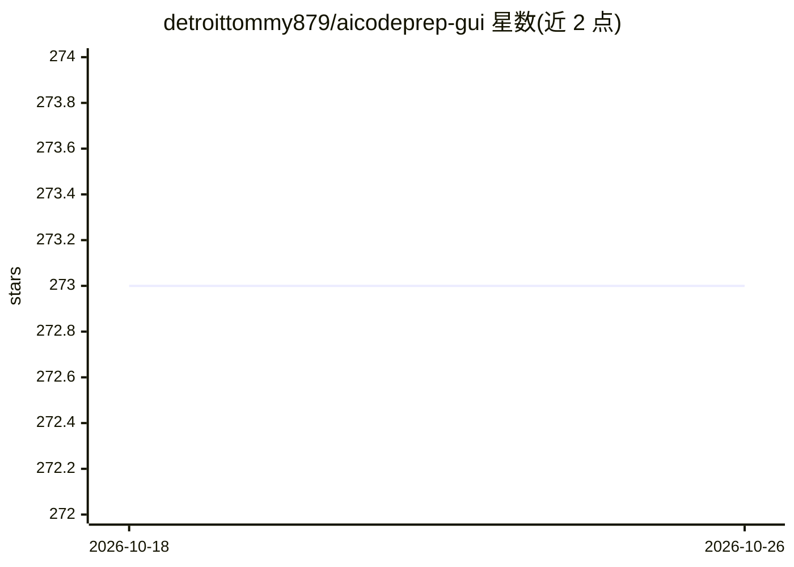

# detroittommy879/aicodeprep-gui

⭐ 273 · Python · NOASSERTION · 推送 2026-10-14 · [GitHub](https://github.com/detroittommy879/aicodeprep-gui) · [官网](https://wuu73.org/aicp) · 个人维护

**把选定项目文件打包成单个上下文块的桌面 GUI，供粘贴到 AI 对话**

基于 Python/Qt 的桌面工具：扫描项目文件夹，让用户勾选文件、附加提示词，生成一个组织好的 Markdown 上下文块，复制到剪贴板并保存为 .aicp/context_block.md，用于粘贴进 ChatGPT、Claude、Gemini 等网页聊天。支持跨编辑器使用（VS Code、Cursor 等）、文件管理器右键集成、toml 配置扫描规则；新版本内置 Rust worker 加速扫描，不可用时回退到 Python 实现。通过 uv/pipx 安装，覆盖 Python 3.9-3.13，Windows/macOS/Linux/BSD 可运行；另有可选 Pro 付费功能。

## 筛选速览

| 维度 | 判定 | 备注 |
|---|---|---|
| AI 角色 | `ai-ecosystem` | LLM/agent 周边工具 |
| 许可风险 | `none` | NOASSERTION |
| 部署形态 | `library` | 以包/库形式分发 |
| 模型依赖 | — | README 未给出锁定关系 |
| 硬件要求 | — | 无带数字的原话,不猜 |
| 安装摩擦 | `low` | 无编译、无系统依赖或容器化 |
| 成熟度 | — | 结构信号不足 |

## 能力要点

- 扫描文件夹、按需勾选文件并生成单一上下文块（剪贴板 + .aicp/context_block.md）
- 可选捆绑 Rust worker 加速扫描，回退到 Python 实现
- Windows/macOS/Linux 文件管理器右键集成打开
- toml 文件自定义扫描（文件大小上限、扩展名等）

## 适用场景

- 跨多文件的 bug 或设计问题，一次性把代码打包发给 AI 对话
- 把同一份上下文发给多个 AI 聊天对比回答
- 在任意编辑器旁生成上下文，先做诊断/规划再交给编辑器或 agent

## 场景标签

 · 领域:开发者工具/LLM 上下文准备

## 证据(README 行号)

> L5: AICodePrep GUI turns selected project files into one clean context block you can paste into an AI chat.
> L7: It solves a simple annoyance: when a bug or design question spans many files, copying those files into ChatGPT, Clau
> L72: 5. Click **Generate Context**.

## 星数曲线

2026-10-18 273 → 2026-10-26 273（+0）

---
*卡片 v1 · prompt 1.4 · 生成 2026-10-22 · 置信度 high · 依据 README sha `c13f8ab76506` · [字段定义](../../DATASET.md)*
