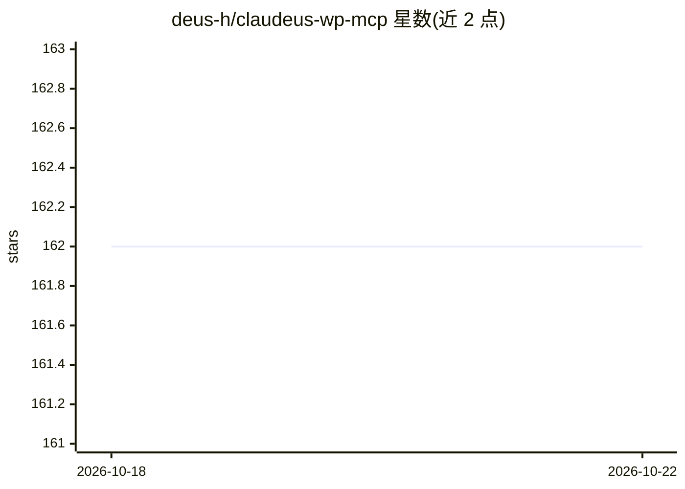

# deus-h/claudeus-wp-mcp

⭐ 162 · TypeScript · NOASSERTION · 推送 2026-03-16 · [GitHub](https://github.com/deus-h/claudeus-wp-mcp) · [官网](https://deusware.se/en/projects/cwpmcp) · 组织维护

**面向 WordPress 的 MCP 服务器：145 个工具供 AI 客户端管理站点**

基于 TypeScript 实现的 WordPress MCP 服务器，通过 WordPress REST API 暴露 145 个工具，覆盖文章/页面/区块 CRUD、FSE 模板与全局样式、媒体、分类、用户与应用密码、评论、菜单、Astra Pro 集成、插件主题管理、站点健康诊断、搜索及 WooCommerce 商品/订单/销售读取。认证支持 Application Password 与 JWT。配置后接入 Claude Desktop 等支持 MCP 协议的 AI 客户端，由 AI 调用这些工具操作站点。由 Deusware AB 团队维护，贡献仅限团队成员。

## 筛选速览

| 维度 | 判定 | 备注 |
|---|---|---|
| AI 角色 | `ai-ecosystem` | LLM/agent 周边工具 |
| 许可风险 | `none` | NOASSERTION |
| 部署形态 | `library` | 以包/库形式分发 |
| 模型依赖 | locked-api |  |
| 硬件要求 | — | 无带数字的原话,不猜 |
| 安装摩擦 | `low` | 无编译、无系统依赖或容器化 |
| 成熟度 | — | 结构信号不足 |

## 能力要点

- 145 个工具覆盖内容、FSE、用户、插件主题、站点健康与 WooCommerce 等 13 类
- 支持 MCP 2024-11-05 规范与 Claude Desktop 集成
- 认证支持 Application Password 与 JWT，附危险级别分级说明
- 提供 MCP Inspector 可视化测试界面

## 适用场景

- 让 Claude Desktop 等 AI 客户端直接管理我的 WordPress 站点内容
- 通过 AI 批量更新文章、管理媒体与用户
- 多站点运维与站点健康监控
- WooCommerce 商品与订单信息查询

## 场景标签

 · 领域:CMS/建站工具 AI 接入

## 证据(README 行号)

> L45: - **Claude Desktop Integration**: First-class MCP protocol support
> L229: ### 2. Configure Claude Desktop

## 星数曲线

2026-10-18 162 → 2026-10-22 162（+0）

---
*卡片 v1 · prompt 1.4 · 生成 2026-10-22 · 置信度 high · 依据 README sha `dc8327aa57d2` · [字段定义](../../DATASET.md)*
