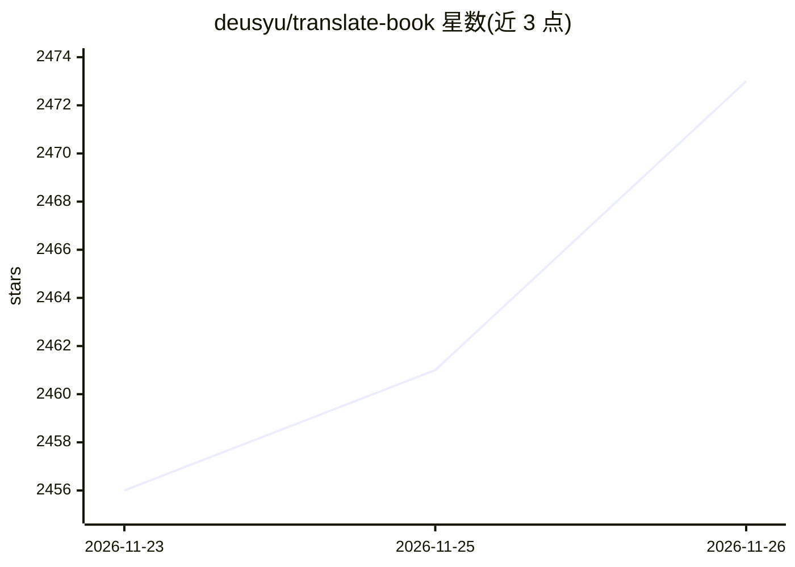

# deusyu/translate-book

⭐ 2,473 · Python · MIT · 推送 2026-11-25 · [GitHub](https://github.com/deusyu/translate-book) · [官网](https://translate.dyu.sh/en/) · 个人维护

**让 Claude Code 等 Agent 用并行子代理整本翻译书籍的技能**

一个 Agent Skills 格式的翻译技能，安装到 Claude Code、Codex、Cursor、OpenClaw 等 Agent 后，将 PDF/DOCX/EPUB 书籍转换为 Markdown 并切块，由 8 个并行子代理分别翻译（各自独立上下文窗口），经 SHA-256 清单校验后合并，输出 HTML/DOCX/EPUB/PDF 多格式。支持块级断点续译、邻近块上下文消解指代、多语言目标（zh/en/ja/ko/fr/de/es 可扩展）。依赖宿主 Agent、Calibre 与 Pandoc；兼容性表中仅 Cursor 与 Codex 标注为已验证。

## 筛选速览

| 维度 | 判定 | 备注 |
|---|---|---|
| AI 角色 | `ai-native` | 本体是模型或模型工具 |
| 许可风险 | `permissive` | MIT |
| 部署形态 | `library` | 以包/库形式分发 |
| 模型依赖 | — | README 未给出锁定关系 |
| 硬件要求 | — | 无带数字的原话,不猜 |
| 安装摩擦 | `low` | 无编译、无系统依赖或容器化 |
| 成熟度 | — | 结构信号不足 |

## 能力要点

- 8 个并行子代理分块翻译，各自独立上下文避免截断
- SHA-256 manifest 校验与 chunk 级断点续译
- 输出 HTML（浮动目录）、DOCX、EPUB、PDF 四种格式
- 依赖 Calibre/Pandoc 做格式转换，公式密集 PDF 可经 MinerU/Marker 预提取

## 适用场景

- 把整本外文书籍翻译成中文等目标语言并生成 EPUB
- 翻译公式、表格较多的学术 PDF（先用 MinerU/Marker 提取为 Markdown）
- 翻译中断后从已完成的块继续而非重头开始

## 场景标签

`AI 写作` · 领域:内容生成

## 证据(README 行号)

> L7: An Agent Skill for Claude Code, Codex, Cursor, OpenClaw and other Agent Skills–compatible agents that translates ent
> L9:  translate-book — a whole book, translated in parallel: split into chunks, translated by 8 parallel sub-agents, veri

## 星数曲线

2026-11-23 2,456 → 2026-11-26 2,473（+17）

---
*卡片 v1 · prompt 1.4 · 生成 2026-11-24 · 置信度 mid · 依据 README sha `4ba596a8cd81` · [字段定义](../../DATASET.md)*
