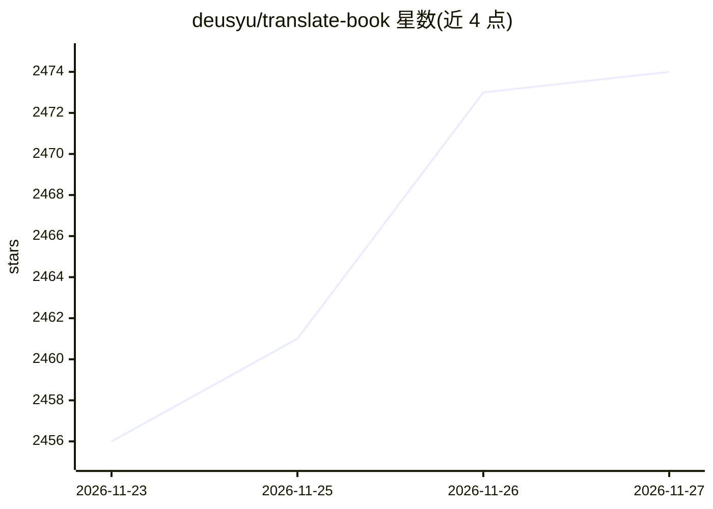

# deusyu/translate-book

⭐ 2,474 · Python · MIT · 推送 2026-11-26 · [GitHub](https://github.com/deusyu/translate-book) · [官网](https://translate.dyu.sh/en/) · 个人维护 · 中文 README

**给 Agent Skills 兼容 Agent 用的整本书多语言翻译技能**

以 Agent Skill 形式分发的整书翻译流水线：将 PDF/DOCX/EPUB/Markdown 输入经 Calibre/Pandoc 转为 Markdown 并切块，由 8 个并行 subagent 翻译，每个子代理使用独立上下文窗口；以 manifest.json 记录 SHA-256 哈希做完整性校验，run_state.json 支持 chunk 级断点续译与敏感词表重译，最终合并并输出 HTML/DOCX/EPUB/PDF。需要支持 subagent 启动的 Agent 运行时及 Calibre、Pandoc、Python 3；不支持启动子代理的 Agent 会在开始前停止。

## 筛选速览

| 维度 | 判定 | 备注 |
|---|---|---|
| AI 角色 | `ai-native` | 本体是模型或模型工具 |
| 许可风险 | `permissive` | MIT |
| 部署形态 | `library` | 以包/库形式分发 |
| 模型依赖 | — | README 未给出锁定关系 |
| 硬件要求 | — | 无带数字的原话,不猜 |
| 安装摩擦 | `low` | 无编译、无系统依赖或容器化 |
| 成熟度 | — | 结构信号不足 |

## 能力要点

- 8 个并行 subagent 分块翻译，每个独立上下文窗口
- SHA-256 manifest 校验与 chunk 级断点续译
- 相邻 chunk 只读摘录用于代词与实体指代消解
- 输出 HTML（浮动目录）、DOCX、EPUB、PDF 四种格式

## 适用场景

- 把整本 PDF/EPUB 电子书翻译成中文或其他语言
- 批量翻译含脚注、公式的技术书籍并保留结构
- 在 Claude Code/Codex/Cursor 中用斜杠命令触发翻译流水线

## 场景标签

 · 领域:翻译/内容处理工具

## 证据(README 行号)

> L5: An Agent Skill for Claude Code, Codex, Cursor, OpenClaw and other Agent Skills–compatible agents that translates ent
> L7:  translate-book — a whole book, translated in parallel: split into chunks, translated by 8 parallel sub-agents, veri
> L35: - **Agent runtime** — any agent that supports Agent Skills and can launch sub-agents from a skill (see Compatibilit

## 星数曲线

2026-11-23 2,456 → 2026-11-27 2,474（+18）

---
*卡片 v1 · prompt 1.4 · 生成 2026-11-27 · 置信度 mid · 依据 README sha `374dc069d541` · [字段定义](../../DATASET.md)*
