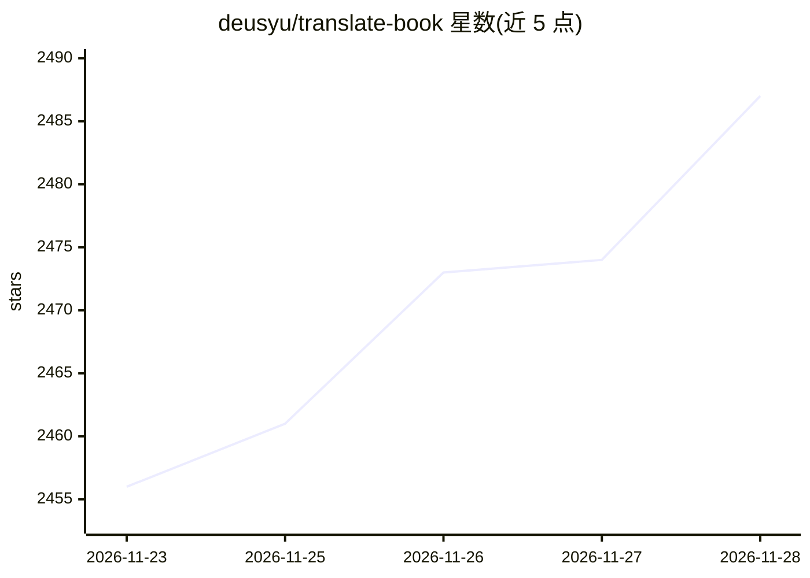

# deusyu/translate-book

⭐ 2,487 · Python · MIT · 推送 2026-11-27 · [GitHub](https://github.com/deusyu/translate-book) · [官网](https://translate.dyu.sh/en/) · 个人维护

**将整本书并行翻译为任意语言的 Agent Skill**

一个可安装到 Claude Code、Codex、Cursor、OpenClaw 等 Agent Skills 兼容代理的技能：将 PDF/DOCX/EPUB/Markdown 图书转换为 Markdown 后切块，由 8 个并行子代理各持独立上下文翻译，经 SHA-256 清单校验后合并，输出 HTML/DOCX/EPUB/PDF 多格式。支持块级断点续译与选择性重译、相邻块只读上下文、防注入的 shell 安全命令设计。依赖 Calibre 与 Pandoc，仅支持 macOS/Linux（Windows 需 WSL）。用户需自备可启动子代理的 agent 运行时。

## 筛选速览

| 维度 | 判定 | 备注 |
|---|---|---|
| AI 角色 | `ai-ecosystem` | LLM/agent 周边工具 |
| 许可风险 | `permissive` | MIT |
| 部署形态 | `library` | 以包/库形式分发 |
| 模型依赖 | — | README 未给出锁定关系 |
| 硬件要求 | — | 无带数字的原话,不猜 |
| 安装摩擦 | `low` | 无编译、无系统依赖或容器化 |
| 成熟度 | — | 结构信号不足 |

## 能力要点

- 8 个并行子代理分块翻译，每个子代理独立上下文窗口
- chunk 级断点续译与 run_state.json 追踪的选择性重译
- SHA-256 清单校验防止过期或损坏输出被合并
- 输出 HTML（浮动目录）、DOCX、EPUB、PDF 多格式

## 适用场景

- 把整本 PDF/EPUB 图书翻译成中文或其他语言
- 长文档翻译中避免单会话上下文溢出与截断
- 翻译中断后从块级别续译，无需从头重跑

## 场景标签

 · 领域:翻译/文档处理

## 证据(README 行号)

> L5: An Agent Skill for Claude Code, Codex, Cursor, OpenClaw and other Agent Skills–compatible agents that translates ent
> L7:  translate-book — a whole book, translated in parallel: split into chunks, translated by 8 parallel sub-agents, veri
> L37: - **Agent runtime** — any agent that supports Agent Skills and can launch sub-agents from a skill (see Compatibilit

## 星数曲线

2026-11-23 2,456 → 2026-11-28 2,487（+31）

---
*卡片 v1 · prompt 1.4 · 生成 2026-11-28 · 置信度 mid · 依据 README sha `67a81286aca8` · [字段定义](../../DATASET.md)*
