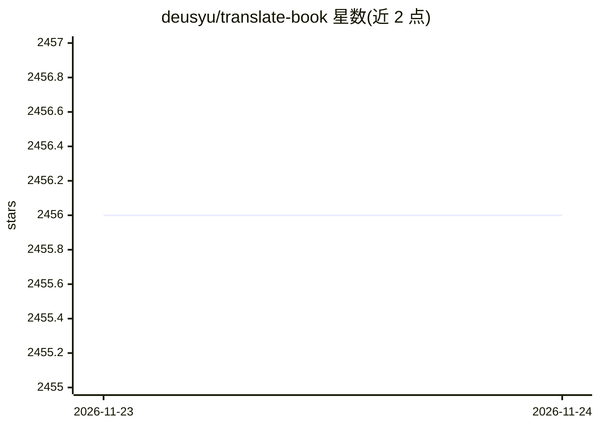

# deusyu/translate-book

⭐ 2,456 · Python · MIT · 推送 2026-11-22 · [GitHub](https://github.com/deusyu/translate-book) · [官网](https://translate.dyu.sh/) · 个人维护

**给 Codex/Claude Code/OpenClaw 用户的整本图书翻译 Agent 技能**

以 Agent skill 形式发布的整书翻译流水线：将 PDF/DOCX/EPUB/Markdown 输入转换为 Markdown 后切块（约 6000 字符/块），由默认 8 个并行子代理各自独立上下文翻译，配合术语表机制保证专有名词跨块一致，用 SHA-256 manifest 校验防止过期或损坏输出被合并，支持块级断点续译与选择性重译，最终产出 HTML（浮动目录）、DOCX、EPUB、PDF 多格式。依赖 Codex/Claude Code/OpenClaw 之一作为运行时，另需 Calibre 与 Pandoc；公式表格密集的 PDF 可选 MinerU/Marker 预提取。维护为单人拥有的 AI 辅助技能流水线，贡献首选 issue 而非 PR。

## 筛选速览

| 维度 | 判定 | 备注 |
|---|---|---|
| AI 角色 | `ai-native` | 本体是模型或模型工具 |
| 许可风险 | `permissive` | MIT |
| 部署形态 | `library` | 以包/库形式分发 |
| 模型依赖 | — | README 未给出锁定关系 |
| 硬件要求 | — | 无带数字的原话,不猜 |
| 安装摩擦 | `low` | 无编译、无系统依赖或容器化 |
| 成熟度 | — | 结构信号不足 |

## 能力要点

- 8 个并行子代理分块翻译，每块独立上下文避免截断
- SHA-256 manifest 校验与块级断点续译（run_state.json）
- 翻译前自动构建术语表并以硬约束注入各块 prompt
- 输出 HTML/DOCX/EPUB/PDF 四种格式，支持源指纹校验防过期复用

## 适用场景

- 把整本 PDF 或 EPUB 书翻译成中文等目标语言
- 翻译公式与表格较多的学术/技术 PDF（配合 MinerU/Marker 预提取）
- 长书中断后续译，或修改术语表后只重译受影响的块

## 场景标签

 · 领域:翻译/文档处理

## 证据(README 行号)

> L7: An agent skill for Codex, Claude Code, and OpenClaw that translates entire books (PDF/DOCX/EPUB) into any language u
> L9:  translate-book — a whole book, translated in parallel: split into chunks, translated by 8 parallel sub-agents, veri
> L37: - **Agent runtime** — Codex, Claude Code, or OpenClaw, installed and ready to run skills

## 星数曲线

2026-11-23 2,456 → 2026-11-24 2,456（+0）

---
*卡片 v1 · prompt 1.4 · 生成 2026-11-23 · 置信度 mid · 依据 README sha `56a3f6ad53bc` · [字段定义](../../DATASET.md)*
