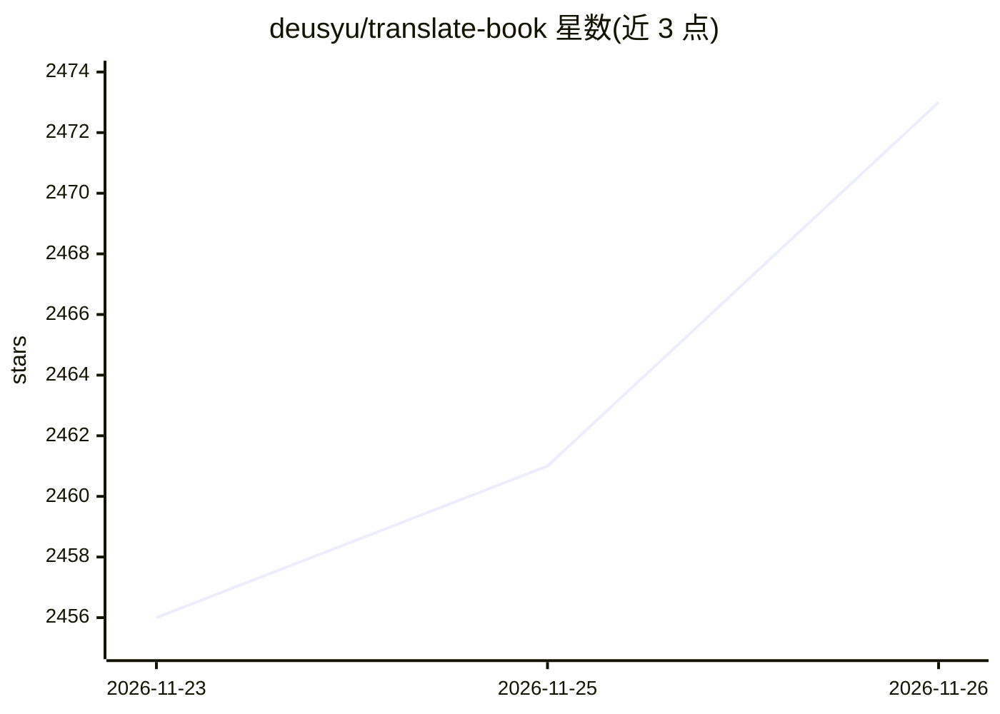

# deusyu/translate-book

⭐ 2,473 · Python · MIT · 推送 2026-11-25 · [GitHub](https://github.com/deusyu/translate-book) · [官网](https://translate.dyu.sh/en/) · 个人维护

**让 Agent 并行翻译整本书（PDF/DOCX/EPUB）的技能**

一个面向 Claude Code、Codex、Cursor、OpenClaw 等 Agent Skills 兼容代理的技能：将整本书转成 Markdown 后切块，由 8 个并行子代理各自在独立上下文中翻译，再用 SHA-256 manifest 校验、可断点续翻并选择性重译，最终合并输出 HTML/DOCX/EPUB/PDF 多格式。依赖宿主代理具备从技能启动子代理的能力，否则停止运行；转换环节依赖系统安装的 Calibre 与 Pandoc。贡献流程以 GitHub issue 为主，PR 非首选路径。

## 筛选速览

| 维度 | 判定 | 备注 |
|---|---|---|
| AI 角色 | `ai-native` | 本体是模型或模型工具 |
| 许可风险 | `permissive` | MIT |
| 部署形态 | `library` | 以包/库形式分发 |
| 模型依赖 | — | README 未给出锁定关系 |
| 硬件要求 | — | 无带数字的原话,不猜 |
| 安装摩擦 | `low` | 无编译、无系统依赖或容器化 |
| 成熟度 | — | 结构信号不足 |

## 能力要点

- 8 个并行子代理独立上下文翻译，避免单会话上下文累积与截断
- chunk 级断点续翻与基于 run_state.json 的术语表敏感重译
- SHA-256 manifest 校验与源指纹防止陈旧/损坏输出被合并
- 输出 HTML（浮动目录）、DOCX、EPUB、PDF 四种格式

## 适用场景

- 把整本 PDF/EPUB/DOCX 书籍翻译成指定语言
- 翻译含公式和表格的技术 PDF（先经版面感知解析器转 Markdown）
- 中断后从具体 chunk 续翻或只重译部分章节

## 场景标签

 · 领域:翻译/文档处理

## 证据(README 行号)

> L5: An Agent Skill for Claude Code, Codex, Cursor, OpenClaw and other Agent Skills–compatible agents that translates ent
> L7:  translate-book — a whole book, translated in parallel: split into chunks, translated by 8 parallel sub-agents, veri
> L20: Each chunk gets its own independent subagent with a fresh context window. This prevents context accumulation and ou

## 星数曲线

2026-11-23 2,456 → 2026-11-26 2,473（+17）

---
*卡片 v1 · prompt 1.4 · 生成 2026-11-26 · 置信度 mid · 依据 README sha `0bc88897eeee` · [字段定义](../../DATASET.md)*
