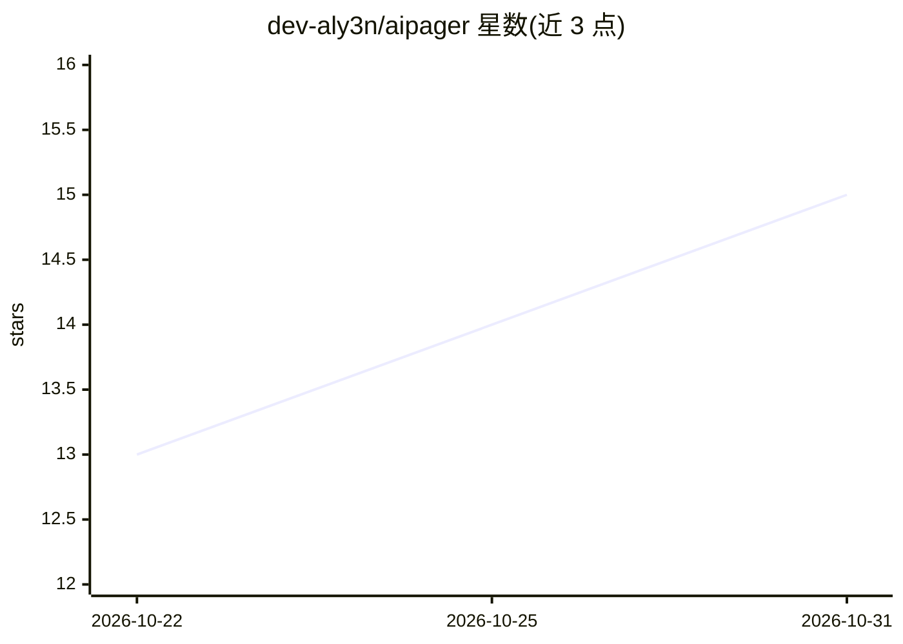

# dev-aly3n/aipager

⭐ 15 · Python · MIT · 推送 2026-10-30 · [GitHub](https://github.com/dev-aly3n/aipager) · [官网](https://aipager.run) · 个人维护

**通过 Telegram 远程操控本机 Claude Code 会话的工具**

aipager 把运行在用户自己电脑上的 Claude Code 终端会话接入 Telegram：Claude 的工具调用、上下文、成本与改动以一张实时编辑的消息卡片呈现；用户可在回合中途输入消息、用按钮回答权限请求。Claude Code 运行于 dtach 内，每步通过 hook 向本地 daemon 发送数据报，daemon 编辑聊天消息，终端保持为事实源。支持三种权限模式、团队群组角色与审计日志、Telegram Mini App 面板、15 种界面语言。无中间服务器，bot token 与会话均在本地。安装覆盖 uv/pipx/Homebrew/Nix/Snap/Docker，要求本机已登录 Claude Code 并创建 Telegram bot。

## 筛选速览

| 维度 | 判定 | 备注 |
|---|---|---|
| AI 角色 | `ai-ecosystem` | LLM/agent 周边工具 |
| 许可风险 | `permissive` | MIT |
| 部署形态 | `self-host` | docker 或自建部署 |
| 模型依赖 | locked-api |  |
| 硬件要求 | — | 无带数字的原话,不猜 |
| 安装摩擦 | `low` | 无编译、无系统依赖或容器化 |
| 成熟度 | — | 结构信号不足 |

## 能力要点

- 每回合一张实时自编辑的卡片，展示工具调用、上下文、成本与改动行
- 回合中途可插入消息，权限请求以按钮形式回答，三种权限模式随时切换
- 团队群组角色（owner/admin/user/read_only）、成员根目录隔离与审计日志
- Claude 运行于 dtach，关闭终端或重启 daemon 后会话继续

## 适用场景

- 出门在外用 Telegram 跟进并指挥家里电脑上的 Claude Code 会话
- 团队在同一个 Telegram 群里按角色协作操作编码 agent
- 在 VPS/NAS/树莓派上用 Docker 容器远程运行 Claude Code

## 场景标签

`编码 Agent` · 领域:编码与开发

## 证据(README 行号)

> L7: Your Claude Code sessions in Telegram, next to your family, your friends and your team.
> L103: Claude Code runs in a real terminal, inside `dtach`, so nobody has to keep a window open. Each step fires a hook t

## 星数曲线

2026-10-22 13 → 2026-10-31 15（+2）

---
*卡片 v1 · prompt 1.4 · 生成 2026-10-31 · 置信度 mid · 依据 README sha `14dd4187cecb` · [字段定义](../../DATASET.md)*
