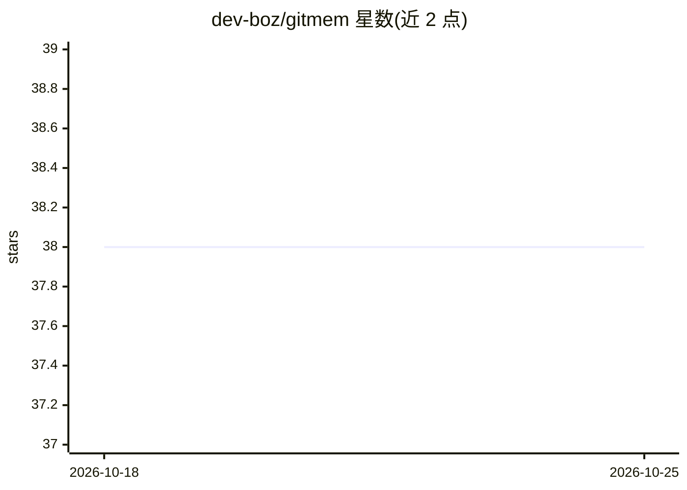

# dev-boz/gitmem

⭐ 38 · Python · MIT · 推送 2026-06-04 · [GitHub](https://github.com/dev-boz/gitmem) · 个人维护

**面向 AI 编码代理的 Git 原生共享记忆层与 MCP 服务器**

为多个 AI CLI 编码代理（Claude Code、Codex、Copilot CLI、Gemini CLI、OpenCode、Amp 等）提供跨工具共享记忆：记忆以 markdown 文件存于独立 git 仓库，经 GitHub 同步，远程模式可经 PR 治理，事实带来源与编码强度（S:1-5）。提供 Dream 管线（抽取/合并/冲突消解/清理）、FTS5 检索与预算感知注入、本地 Web 查看器、TUI 与 MCP 服务器。Python 3.11+，pip 从 GitHub 安装。自述 Alpha 版本，GitHub PR 治理为实验性；本地模式无需 API key。

## 筛选速览

| 维度 | 判定 | 备注 |
|---|---|---|
| AI 角色 | `ai-ecosystem` | LLM/agent 周边工具 |
| 许可风险 | `permissive` | MIT |
| 部署形态 | `library` | 以包/库形式分发 |
| 模型依赖 | — | README 未给出锁定关系 |
| 硬件要求 | — | 无带数字的原话,不猜 |
| 安装摩擦 | `low` | 无编译、无系统依赖或容器化 |
| 成熟度 | `idea` | |

## 能力要点

- 记忆存为 git 仓库中 markdown 文件，经 GitHub 同步并可经 PR 治理
- 支持 Codex/Copilot/Claude Code/Gemini CLI/OpenCode/Amp 会话转录采集
- Dream 管线：事实抽取、合并、冲突消解、lint、清理
- 事实携带编码强度（S:1-5）与来源，源码事实不可被 LLM 推断覆盖

## 适用场景

- 多个 AI 编码工具在同一代码库上共享事实与上下文
- 审计并纠正 agent 学到的错误记忆
- 通过 PR 审查 agent 新增的事实条目

## 场景标签

`Agent 记忆` · 领域:Agent 开发

## 证据(README 行号)

> L5: **Git-native shared memory and MCP server for AI coding agents.**
> L37: - integrations: Claude Code hooks, shims, bridge files, backup/export/import, MCP server
> L90: **Tool-agnostic by design.** gitmem is a filesystem convention and injection protocol, not a service. It doesn't wr

## 星数曲线

2026-10-18 38 → 2026-10-25 38（+0）

---
*卡片 v1 · prompt 1.4 · 生成 2026-10-25 · 置信度 mid · 依据 README sha `ebdcdcfbd9c1` · [字段定义](../../DATASET.md)*
