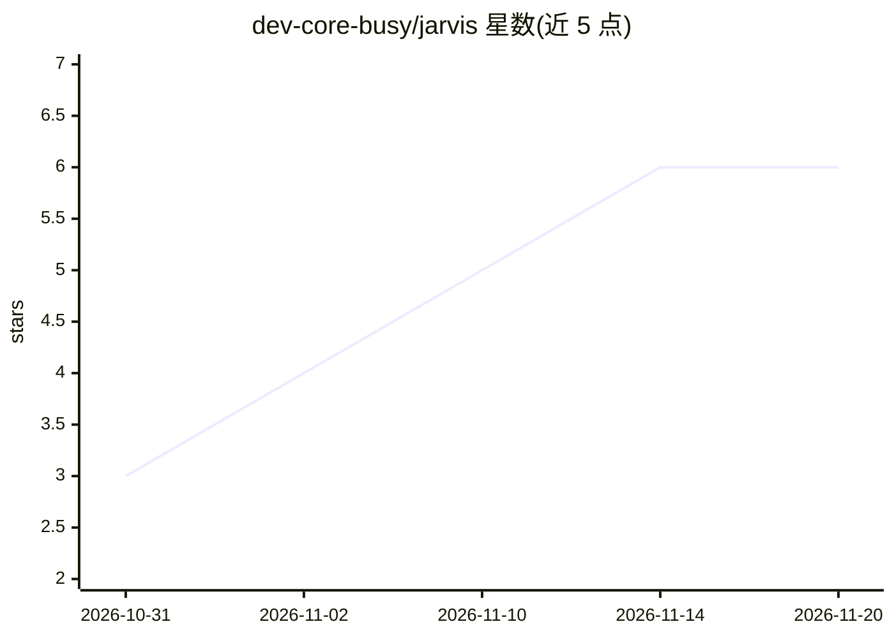

# dev-core-busy/jarvis

⭐ 6 · Python · NOASSERTION · 推送 2026-11-19 · [GitHub](https://github.com/dev-core-busy/jarvis) · [官网](https://jarvis-ai.info) · 组织维护

**自托管 Linux 桌面 AI 代理：自然语言操控桌面执行任务**

运行在 Linux 服务器上的自托管 AI 代理平台：通过网页聊天、Outlook/Excel 任务面板或 WhatsApp 接收自然语言目标，规划并执行浏览网页、读写文件、运行代码、生成 Office 文档、管理日历等操作，支持 VNC 实时查看桌面控制过程。内置混合 RAG 知识库（FAISS + BM25）、多代理角色委派、子代理并行、技能系统，并按 BSI IT-Grundschutz APP.3.1 与 TR-02102 实现 34 项安全措施（沙箱执行、2FA、提示注入检测）。

## 筛选速览

| 维度 | 判定 | 备注 |
|---|---|---|
| AI 角色 | `ai-native` | 本体是模型或模型工具 |
| 许可风险 | `none` | NOASSERTION |
| 部署形态 | `None` |  |
| 模型依赖 | local-ok | 支持本地模型 |
| 硬件要求 | — | 无带数字的原话,不猜 |
| 安装摩擦 | `medium` | 含编译或系统依赖之一 |
| 成熟度 | — | 结构信号不足 |

## 能力要点

- 多 LLM 切换：Gemini/Claude/OpenRouter/本地 Ollama/OpenAI 兼容端点
- VNC 实时桌面控制与截图回传 LLM 上下文
- 混合 RAG 知识库：FAISS 语义通道 + BM25，RRF 融合
- 按 BSI APP.3.1/TR-02102 实现的沙箱与权限分离

## 适用场景

- 通过 WhatsApp 或网页聊天给团队 AI 代理分派任务
- 在 Outlook/Excel 中让代理处理邮件、表格与日程
- 自建企业知识库并按 BSI 安全要求开放给团队使用

## 场景标签

`多智能体` `RAG` `知识库管理` · 领域:Agent 开发

## 证据(README 行号)

> L95: Jarvis is a **self-hosted AI chatbot with a huge feature set** that runs on a Linux server. Give it a goal in plain
> L102: Jarvis handles it — and because it's **multi-LLM**, **multi-user**, and wrapped in a real **security layer with sa
> L147: ### 📚 Knowledge Base (hybrid RAG)

## 星数曲线

2026-10-31 3 → 2026-11-20 6（+3）

---
*卡片 v1 · prompt 1.4 · 生成 2026-11-20 · 置信度 high · 依据 README sha `c072f33a3bd0` · [字段定义](../../DATASET.md)*
