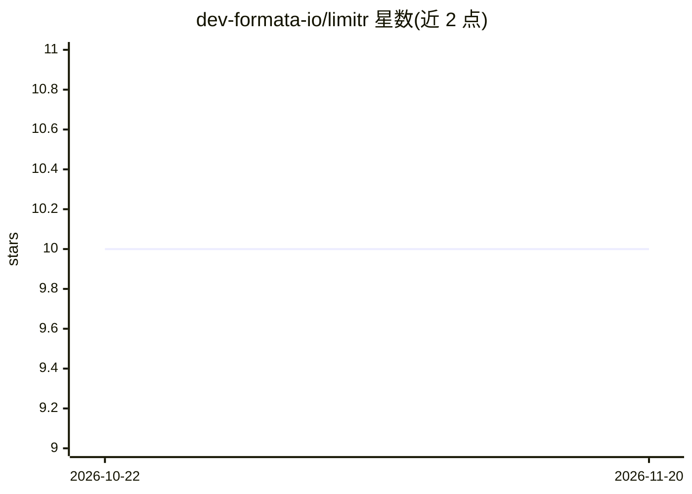

# dev-formata-io/limitr

⭐ 10 · TypeScript · Apache-2.0 · 推送 2026-11-19 · [GitHub](https://github.com/dev-formata-io/limitr) · [官网](https://limitr.dev) · 组织维护

**面向 AI 应用的用量计量与计费引擎：额度、上限与定价策略**

Limitr 是一个以库形式嵌入应用的开源引擎（TypeScript/JavaScript 与 Python）：开发者在一个策略文件中编写套餐、额度与价格，应用在执行收费动作前调用 allow() 判定是否放行、计数用量并计算向客户收取与自身支出的成本。支持 feature flags、速率限制、消费上限、credits/充值/席位/超额计价，策略可版本化、热更新。可选的 Limitr Cloud 提供控制台、发票与实时策略下发。附 Claude Code 插件与面向编码 agent 的 skills。

## 筛选速览

| 维度 | 判定 | 备注 |
|---|---|---|
| AI 角色 | `ai-ecosystem` | LLM/agent 周边工具 |
| 许可风险 | `permissive` | Apache-2.0 |
| 部署形态 | `library` | 以包/库形式分发 |
| 模型依赖 | — | README 未给出锁定关系 |
| 硬件要求 | — | 无带数字的原话,不猜 |
| 安装摩擦 | `low` | 无编译、无系统依赖或容器化 |
| 成熟度 | `idea` | |

## 能力要点

- 策略文件定义套餐/价格/上限，改动不改代码、可版本化与回滚
- 引擎以库形式在应用进程内运行，约毫秒级返回 allow() 判定
- reserve-and-settle 机制为并发 agent 任务预留额度
- 提供 Limitr Network 协议，agent 可用签名 voucher 调用服务

## 适用场景

- 为 AI 产品按 token 用量向客户计费并控制成本
- 给不同客户配置自定义合同、超额与充值额度
- 限制自有 agent 任务的消费上限与并发用量

## 场景标签

 · 领域:AI 应用基础设施/计量计费

## 证据(README 行号)

> L18: Limitr decides what each customer can use and what it costs. You write your plans, limits, and prices in one
> L22: The engine is open source and runs inside your app, in TypeScript/JavaScript or Python. Limitr Cloud
> L74: Limitr isn't a service your app calls. It's an engine your app runs, like a library: the policy and your customers

## 星数曲线

2026-10-22 10 → 2026-11-20 10（+0）

---
*卡片 v1 · prompt 1.4 · 生成 2026-11-19 · 置信度 high · 依据 README sha `bdd1c9fa9b44` · [字段定义](../../DATASET.md)*
