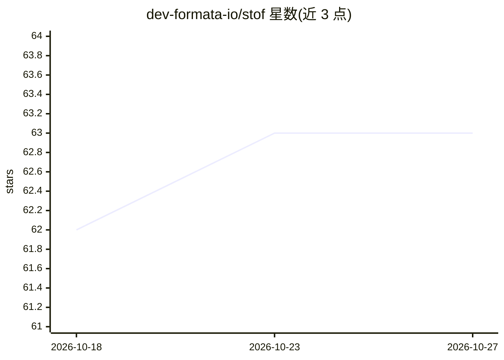

# dev-formata-io/stof

⭐ 63 · Rust · Apache-2.0 · 推送 2026-10-21 · [GitHub](https://github.com/dev-formata-io/stof) · [官网](https://stof.dev) · 组织维护

**在应用内沙箱运行 AI 生成逻辑的文档格式与运行时库**

Stof 是一种把数据与函数放在同一文档的格式（JSON 超集），提供 Rust、JavaScript/TypeScript、Python 三种进程内运行时库。定位是让模型生成的小段逻辑（规则、过滤、转换、打分）在沙箱中安全执行：文档默认无文件系统、网络、环境访问，宿主通过注册函数与 allow_http/allow_system 显式授权，每次调用带时间限制。文档可像数据一样合并、diff、序列化为紧凑二进制传输，跨 Rust/Node/浏览器/Python 结果一致。支持 JSON/YAML/TOML 导入导出，内含类型、schema、单位与文档内测试。限制：不适合应用自身逻辑、计算密集或长驻服务。以 npm、crate、pip 及 CLI 提供，Apache 2.0 许可。

## 筛选速览

| 维度 | 判定 | 备注 |
|---|---|---|
| AI 角色 | `ai-ecosystem` | LLM/agent 周边工具 |
| 许可风险 | `permissive` | Apache-2.0 |
| 部署形态 | `library` | 以包/库形式分发 |
| 模型依赖 | — | README 未给出锁定关系 |
| 硬件要求 | — | 无带数字的原话,不猜 |
| 安装摩擦 | `low` | 无编译、无系统依赖或容器化 |
| 成熟度 | — | 结构信号不足 |

## 能力要点

- 数据与逻辑合一的文档格式，沙箱内进程运行，小文档解析运行低于 1 毫秒
- 默认无文件系统/网络/环境访问，宿主按函数与主机白名单显式授权，调用带时间限制
- Rust、Node.js、浏览器、Python 跨端运行结果一致，支持合并/diff/二进制序列化传输
- 内含类型与 schema、单位运算、文档内测试（#[test]），支持 JSON/YAML/TOML 导入导出

## 适用场景

- 把模型输出的路由规则、校验、数据转换安全地在应用内执行
- 同一逻辑需要在浏览器、服务端、worker 多处运行且结果一致
- 不自己发明配置格式或规则引擎，直接用可运行文档承载产品规则
- 团队策略、模型规则与 API 数据合并为一个文档统一执行

## 场景标签

 · 领域:开发工具/运行时库

## 证据(README 行号)

> L7:  Run AI-generated logic safely, inside your app.
> L124: Load data from anywhere, add logic, run it, and keep the document or throw it away. The runtime is a library (npm,

## 星数曲线

2026-10-18 62 → 2026-10-27 63（+1）

---
*卡片 v1 · prompt 1.4 · 生成 2026-10-24 · 置信度 high · 依据 README sha `adbbe8901f38` · [字段定义](../../DATASET.md)*
