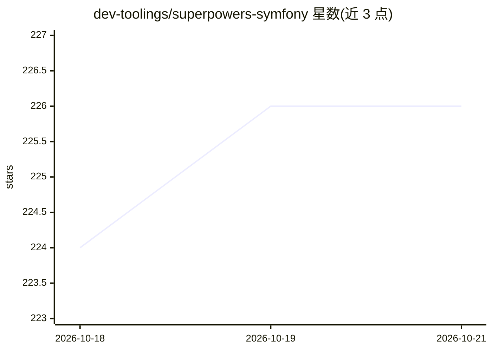

# dev-toolings/superpowers-symfony

⭐ 226 · TypeScript · MIT · 推送 2026-10-05 · [GitHub](https://github.com/dev-toolings/superpowers-symfony) · 组织维护

**给 AI 编程 agent 的 Symfony 专家技能库（44 技能/7 agent/13 命令）**

面向 AI 编程 agent 的 Symfony 领域技能内容库：44 个技能、7 个子 agent 与 13 个命令，覆盖 API Platform（v5/4.4/4.3）、Doctrine ORM 3、TDD（Pest/PHPUnit）、Messenger、安全与 DDD/六边形架构，内容为纯 Markdown 的 Agent Skills 布局，按各 harness 生成打包产物并由 CI 保证一致。支持 Claude Code 插件市场、Codex CLI、Grok Build、OpenCode、Cursor、Windsurf、GitHub Copilot、Gemini CLI、aider 等接入，另含 bin/symfony-context 运行时检测脚本。MIT 许可，定位 Symfony 7.4 LTS/8.x。

## 筛选速览

| 维度 | 判定 | 备注 |
|---|---|---|
| AI 角色 | `ai-knowledge` | 知识聚合/清单类 |
| 许可风险 | `permissive` | MIT |
| 部署形态 | `self-host` | docker 或自建部署 |
| 模型依赖 | — | README 未给出锁定关系 |
| 硬件要求 | — | 无带数字的原话,不猜 |
| 安装摩擦 | `low` | 无编译、无系统依赖或容器化 |
| 成熟度 | — | 结构信号不足 |

## 能力要点

- 44 技能 + 7 子 agent + 13 命令，纯 Markdown、按 harness 生成打包
- 覆盖 API Platform 5/4.4/4.3、Doctrine ORM 3、Pest/PHPUnit TDD、Messenger、安全、DDD
- 10 种编程 agent harness 的安装/接入方式（插件市场、AGENTS.md、rules 等）
- bin/symfony-context 检测 Symfony 版本、Docker 环境与测试框架并输出正确命令前缀

## 适用场景

- 让 Claude Code 等 AI 编程 agent 在 Symfony 项目中获得版本匹配的框架知识
- 为 API Platform / Doctrine ORM 3 项目提供 TDD 与架构（CQRS、六边形）实践指引
- 在多个 AI 编程工具间复用同一套 Symfony 技能内容

## 场景标签

`编码 Agent` · 领域:编码与开发

## 证据(README 行号)

> L3: > **Version-accurate Symfony expertise for AI coding agents.** 44 expert skills, 7 specialized agents and 13 command
> L13: The content is deliberately vendor-neutral: skills are plain Markdown in the open
> L20:    content/        ← the source of truth: 44 skills, 7 agents, 13 commands

## 星数曲线

2026-10-18 224 → 2026-10-21 226（+2）

---
*卡片 v1 · prompt 1.4 · 生成 2026-10-22 · 置信度 mid · 依据 README sha `774b8aeaf2b1` · [字段定义](../../DATASET.md)*
