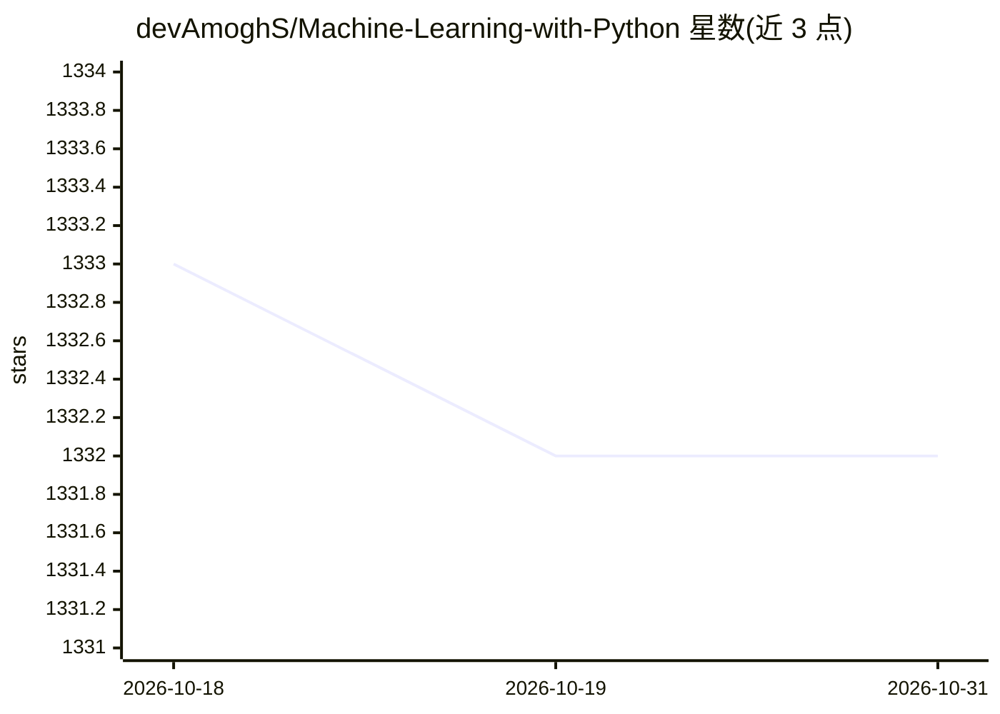

# devAmoghS/Machine-Learning-with-Python

⭐ 1,332 · Python · MIT · 推送 2026-04-14 · [GitHub](https://github.com/devAmoghS/Machine-Learning-with-Python) · 个人维护

**Python 机器学习小型练习项目集合，供学习者理解核心概念**

一组小规模机器学习与数据科学练习项目，覆盖主题建模（LDA）、MNIST 神经网络、线性/逻辑回归、随机森林、朴素贝叶斯垃圾邮件过滤、K-means 聚类、推荐系统、PageRank 等网络分析与假设检验方法，多数基于 Scikit-Learn 与 Keras 实现，另含统计/概率/线性代数辅助方法。面向机器学习入门学习者。安装方式为用 Conda 创建 Python 3.5 虚拟环境并按 requirements.txt 安装依赖；README 提到文档与 FAQ 仍在准备中。

## 筛选速览

| 维度 | 判定 | 备注 |
|---|---|---|
| AI 角色 | `ai-knowledge` | 知识聚合/清单类 |
| 许可风险 | `permissive` | MIT |
| 部署形态 | `None` |  |
| 模型依赖 | — | README 未给出锁定关系 |
| 硬件要求 | — | 无带数字的原话,不猜 |
| 安装摩擦 | `low` | 无编译、无系统依赖或容器化 |
| 成熟度 | — | 结构信号不足 |

## 能力要点

- 覆盖 LDA 主题建模、神经网络、随机森林、K-means 等多种经典算法实现
- 包含从零实现的随机森林与多种网络分析（PageRank/中心性）方法
- 提供 Conda 环境搭建与依赖安装步骤

## 适用场景

- 通过小项目练习机器学习核心概念
- 参考经典算法的 Python/Scikit-Learn 实现方式
- 学习统计、概率与数据分析的常用操作

## 场景标签

`教程课程` · 领域:学习与行业

## 证据(README 行号)

> L5: ## Small scale machine learning projects to understand the core concepts (order: oldest to newest)
> L6: * Topic Modelling using **Latent Dirichlet Allocation** with newsgroups20 dataset, implemented with Python and Sciki

## 星数曲线

2026-10-18 1,333 → 2026-10-31 1,332（-1）

---
*卡片 v1 · prompt 1.4 · 生成 2026-10-21 · 置信度 mid · 依据 README sha `90388dd6c825` · [字段定义](../../DATASET.md)*
