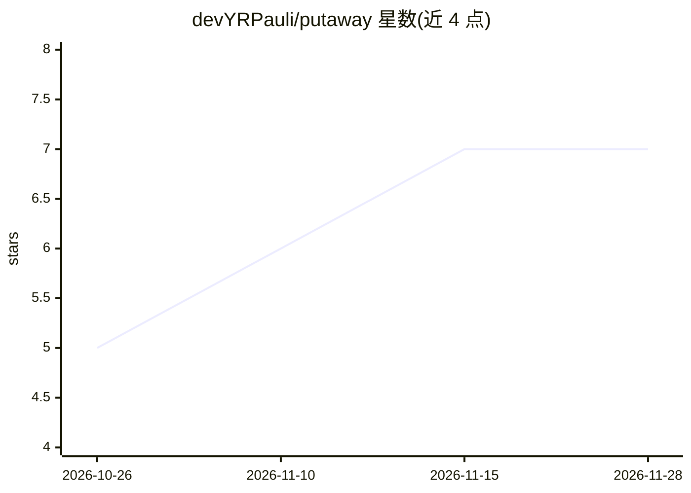

# devYRPauli/putaway

⭐ 7 · Swift · MIT · 推送 2026-10-16 · [GitHub](https://github.com/devYRPauli/putaway) · 个人维护

**Mac 菜单栏与 CLI 工具：把下载文件归入既有文件夹**

面向 macOS 用户的文件整理工具：读取目标文件夹（如 Downloads）中每个文件，从用户已有文件夹中挑选归属，生成归档计划；确定项可直接移动，其余需逐个确认，支持 Undo 回滚。分类由三类引擎完成：Apple Intelligence（默认，本地运行）、自建 OpenAI 兼容服务器（Ollama/LM Studio/llama.cpp/mlx_lm）、或 SubQ/TypeSafe API key。隐私上不读取 .env、密钥等敏感文件，使用云服务时仅发送文件夹名与文本前 1000 字符。

## 筛选速览

| 维度 | 判定 | 备注 |
|---|---|---|
| AI 角色 | `ai-native` | 本体是模型或模型工具 |
| 许可风险 | `permissive` | MIT |
| 部署形态 | `None` |  |
| 模型依赖 | local-ok | 支持本地模型 |
| 硬件要求 | — | 无带数字的原话,不猜 |
| 安装摩擦 | `low` | 无编译、无系统依赖或容器化 |
| 成熟度 | — | 结构信号不足 |

## 能力要点

- 三种分类引擎：Apple Intelligence / 自建 OpenAI 兼容服务器 / SubQ·Jev API
- 先出计划再移动，nothing moves until you click Move，支持 Undo
- 敏感文件保护：跳过 .env/id_rsa/*.pem 等，疑似密钥文本不上传
- 菜单栏应用与 putaway CLI 共用同一引擎

## 适用场景

- 把 Downloads 里的文件自动归入已有的文件夹结构
- 用本地模型离线分类文件，数据不出本机
- 通过 Finder 右键菜单整理任意文件夹

## 场景标签

 · 领域:macOS 生产力/文件管理工具

## 证据(README 行号)

> L3: Putaway files the contents of a folder into the folders you already have.
> L30: Putaway does not include a cloud service. It uses Apple Intelligence on your Mac by default. To change that, click 
> L32: - **Apple Intelligence**: the default. It is free, runs on your Mac, and needs Apple Intelligence turned on. It sug

## 星数曲线

2026-10-26 5 → 2026-11-28 7（+2）

---
*卡片 v1 · prompt 1.4 · 生成 2026-11-20 · 置信度 high · 依据 README sha `e70956dcd526` · [字段定义](../../DATASET.md)*
