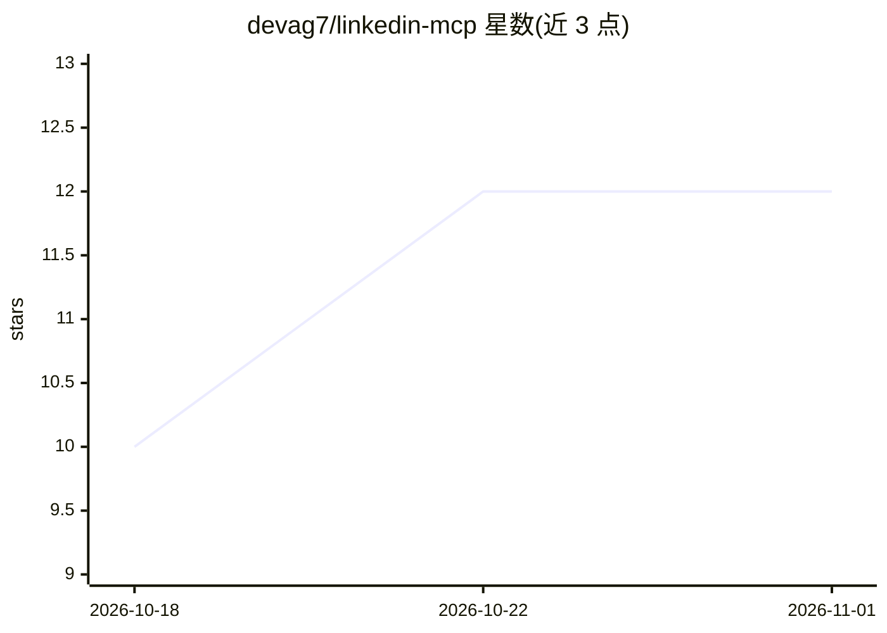

# devag7/linkedin-mcp

⭐ 12 · TypeScript · MIT · 推送 2026-10-30 · [GitHub](https://github.com/devag7/linkedin-mcp) · [官网](https://github.com/devag7/linkedin-mcp#readme) · 个人维护

**让 AI 助手通过 LinkedIn API 结构化读写资料的 MCP 服务器**

面向 MCP 客户端（Claude Desktop、Cursor、VS Code）的 LinkedIn 集成服务器：用 Patchright 维持一个持久的 Google Chrome 登录会话，发送 Voyager 请求，把档案、职位、公司、收件箱等数据以 JSON 返回。提供 24 个工具，写入类操作（connect/message/post/react/comment）默认禁用，启用时需确认令牌并消耗保守预算。非官方集成，账号可能被限制；本地 stdio 为主，HTTP 仅限 loopback。

## 筛选速览

| 维度 | 判定 | 备注 |
|---|---|---|
| AI 角色 | `ai-ecosystem` | LLM/agent 周边工具 |
| 许可风险 | `permissive` | MIT |
| 部署形态 | `self-host` | docker 或自建部署 |
| 模型依赖 | — | README 未给出锁定关系 |
| 硬件要求 | — | 无带数字的原话,不猜 |
| 安装摩擦 | `low` | 无编译、无系统依赖或容器化 |
| 成熟度 | `idea` | |

## 能力要点

- 基于 Patchright 持久 Chrome 会话读取 LinkedIn 数据并输出结构化 JSON
- 24 个工具，写入操作默认禁用且需显式确认与预算控制
- 离线 setup 诊断生成客户端配置，不联系 LinkedIn
- 本地 HTTP 模式仅限 loopback 且需 Bearer token

## 适用场景

- 让 Claude/Cursor 等 MCP 客户端读取 LinkedIn 档案、职位与公司信息
- 求职场景中做资料调研与收件箱整理
- 在显式确认下让 AI 助手发送消息或建立连接

## 场景标签

`网页抓取` · 领域:效率与自动化

## 证据(README 行号)

> L12: **Structured LinkedIn reads for MCP clients — profiles, jobs, companies and inbox data, with guided offline setup a
> L83: The server uses Patchright to open a persistent Google Chrome profile and makes
> L84: Voyager requests from its authenticated page. Results are shaped into JSON for

## 星数曲线

2026-10-18 10 → 2026-11-01 12（+2）

---
*卡片 v1 · prompt 1.4 · 生成 2026-11-01 · 置信度 mid · 依据 README sha `b1ac19ed8814` · [字段定义](../../DATASET.md)*
