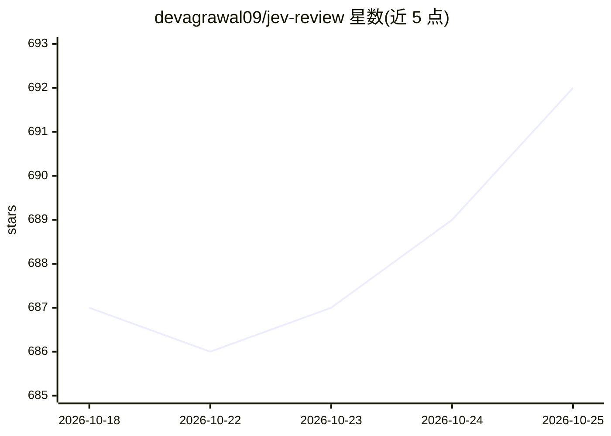

# devagrawal09/jev-review

⭐ 692 · TypeScript · MIT · 推送 2026-09-17 · [GitHub](https://github.com/devagrawal09/jev-review) · 个人维护

**基于 TypeSafe Jev 的本地代码审查工作流与仪表盘**

用 TypeScript 编写的代码审查工具：编排逻辑保留在代码中，通过 TypeSafe Jev 进行有界的结构化模型判断，对 Git diff 或完整代码库进行审查，筛查正确性、安全性、可靠性、兼容性与测试覆盖，并在绑定 127.0.0.1 的本地仪表盘中展示结果。提供 change-review 与 codebase-scan 两个入口，依赖 Node.js 24+、Git 与 TypeSafe API key，npm 安装运行。作者声明这是实验性项目，尚未集成编译器诊断、静态分析器或仓库索引，产出是审查提示而非缺陷证明。

## 筛选速览

| 维度 | 判定 | 备注 |
|---|---|---|
| AI 角色 | `ai-native` | 本体是模型或模型工具 |
| 许可风险 | `permissive` | MIT |
| 部署形态 | `library` | 以包/库形式分发 |
| 模型依赖 | — | README 未给出锁定关系 |
| 硬件要求 | — | 无带数字的原话,不猜 |
| 安装摩擦 | `low` | 无编译、无系统依赖或容器化 |
| 成熟度 | `idea` | |

## 能力要点

- 对 Git diff 或完整代码库两种入口进行审查
- 通过 Choice/Score 结构化模型判断完成风险矩阵、证据选择、机制分类与严重度评分
- 筛查正确性、安全、可靠性、兼容性与测试覆盖五个维度
- 本地仪表盘绑定 127.0.0.1，分层架构由依赖检查脚本强制约束

## 适用场景

- 在提交前让模型审查当前 diff 的风险点
- 对整个代码库做一次结构化扫描并保存报告
- 在本地仪表盘中查看分组折叠的审查报告

## 场景标签

`代码审查` · 领域:编码与开发

## 证据(README 行号)

> L3: A small code-review workflow built with TypeSafe Jev. It can review a Git diff or scan a complete codebase, follows 
> L9: The reviewer keeps orchestration in code and uses Jev for bounded judgments:

## 星数曲线

2026-10-18 687 → 2026-10-25 692（+5）

---
*卡片 v1 · prompt 1.4 · 生成 2026-10-21 · 置信度 high · 依据 README sha `ecdf8dd15673` · [字段定义](../../DATASET.md)*
