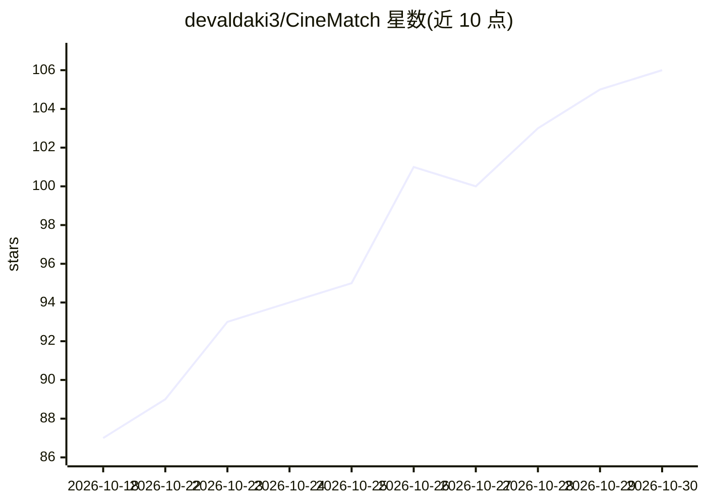

# devaldaki3/CineMatch

⭐ 106 · Jupyter Notebook · 推送 2026-04-18 · [GitHub](https://github.com/devaldaki3/CineMatch) · [官网](https://cinematch-40bc.onrender.com/) · 个人维护

**电影推荐 Web 应用：混合评分推荐 + 实时影评情感分析**

基于 Flask 的电影推荐 Web 应用：用户搜索一部电影后，通过内容相似度（75%）与全球热度（25%）的混合评分算法生成 10 部推荐；经 TMDb API 并行拉取海报、片长、类型、演员与实时影评，影评由训练好的 Multinomial Naive Bayes N-Gram 分类器输出 Good/Bad 二元情感判定。特征向量预归一化后以稀疏矩阵点积计算，配套双层内存缓存。本地运行需自建 Python 虚拟环境并配置 TMDb API 使用。

## 筛选速览

| 维度 | 判定 | 备注 |
|---|---|---|
| AI 角色 | `ai-native` | 本体是模型或模型工具 |
| 许可风险 | `none` | — |
| 部署形态 | `library` | 以包/库形式分发 |
| 模型依赖 | — | README 未给出锁定关系 |
| 硬件要求 | — | 无带数字的原话,不猜 |
| 安装摩擦 | `low` | 无编译、无系统依赖或容器化 |
| 成熟度 | — | 结构信号不足 |

## 能力要点

- 混合评分：内容相似度 75% + 全球热度 25%，输出 10 部推荐
- Multinomial Naive Bayes 分类器对 TMDb 实时影评做 Good/Bad 情感判定
- 16 线程并行请求 TMDb API + 双层内存缓存
- TfidfVectorizer 特征提取，预归一化稀疏矩阵（.npz）点积计算相似度

## 适用场景

- 按我喜欢的电影快速获取候选片单
- 查看某部电影实时观众影评的情感倾向
- 在桌面或手机浏览器本地部署运行推荐服务

## 场景标签

`推荐系统` · 领域:学习与行业

## 证据(README 行号)

> L15: **CineMatch** eliminates the paradox of choice for movie nights. By simply searching for a movie you love, our hybr
> L20: - 🎭 **Real-Time Sentiment Analysis:** Fetches dynamic live reviews via the TMDb API and runs them through a trained

## 星数曲线

2026-10-18 87 → 2026-10-30 106（+19）

---
*卡片 v1 · prompt 1.4 · 生成 2026-10-23 · 置信度 mid · 依据 README sha `5f59d7ca8b6b` · [字段定义](../../DATASET.md)*
