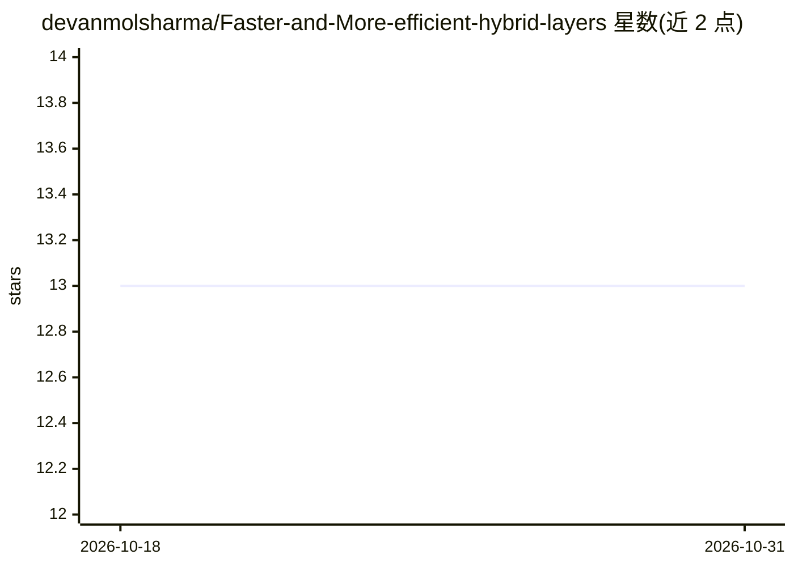

# devanmolsharma/Faster-and-More-efficient-hybrid-layers

⭐ 13 · Python · 推送 2026-10-14 · [GitHub](https://github.com/devanmolsharma/Faster-and-More-efficient-hybrid-layers) · [官网](https://devanmolsharma.github.io/mind_your_own_kernel/) · 个人维护

**PyTorch 动态卷积层实现：按图像 patch 预测卷积核**

研究性 PyTorch 项目：实现自定义 Conv2d 层（hybrids.DynamicConv），用混合 dense 层根据每个输入 patch 的内容动态预测卷积核，替代存储固定核，以减少参数量与计算量。提供 import hybrids 的使用方式、训练 Notebook 与多个预训练 checkpoint（89KB 至 10MB 的 encoder 与 autoencoder）。作者自述论文非专业出品，训练代码标注可能需修复，属早期实验性研究代码。

## 筛选速览

| 维度 | 判定 | 备注 |
|---|---|---|
| AI 角色 | `ai-native` | 本体是模型或模型工具 |
| 许可风险 | `none` | — |
| 部署形态 | `None` |  |
| 模型依赖 | — | README 未给出锁定关系 |
| 硬件要求 | — | 无带数字的原话,不猜 |
| 安装摩擦 | `low` | 无编译、无系统依赖或容器化 |
| 成熟度 | `idea` | |

## 能力要点

- DynamicConv 类按 patch 动态预测卷积核
- 提供多个小体积 encoder/autoencoder 预训练 checkpoint
- 附带训练 Notebook（作者标注可能需修复）

## 适用场景

- 研究动态卷积在小模型上的特征提取效果
- 在 PyTorch 项目中试用 patch 级核预测层
- 复现论文中的小体积 encoder 实验

## 场景标签

 · 领域:计算机视觉/深度学习

## 证据(README 行号)

> L12: In this paper, we propose a custom Conv2d class, where kernels are predicted dynamically using a hybrid dense layer
> L20:   A = hybrids.DynamicConv(2,4)

## 星数曲线

2026-10-18 13 → 2026-10-31 13（+0）

---
*卡片 v1 · prompt 1.4 · 生成 2026-10-31 · 置信度 high · 依据 README sha `897399712a13` · [字段定义](../../DATASET.md)*
