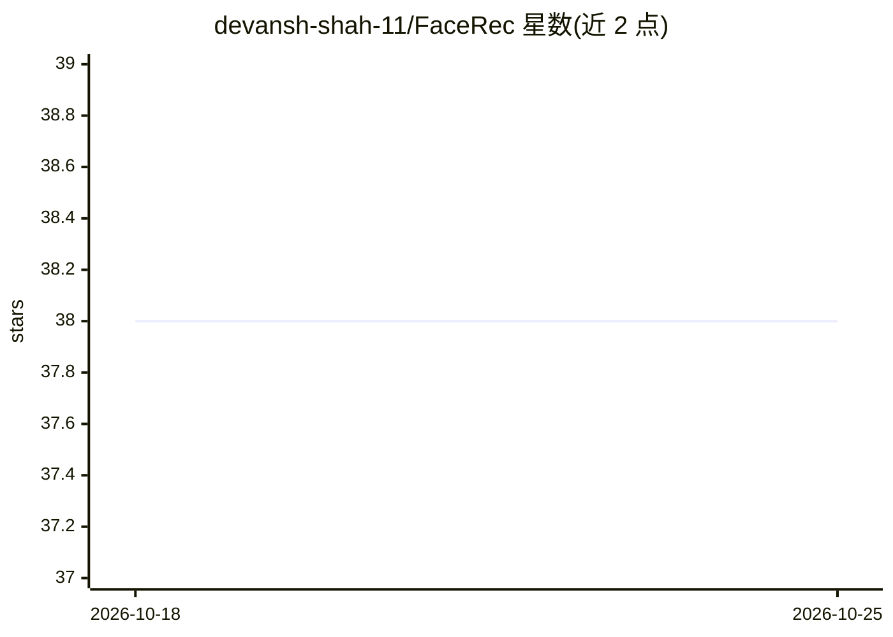

# devansh-shah-11/FaceRec

⭐ 38 · Jupyter Notebook · Apache-2.0 · 推送 2026-04-13 · [GitHub](https://github.com/devansh-shah-11/FaceRec) · 个人维护

**基于深度学习的人脸识别系统：注册、识别与元数据管理**

使用 Flask、FastAPI、DeepFace 与 MongoDB 构建的人脸识别 Web 应用：支持实时人脸检测与识别，用户可注册人脸图像及关联元数据（员工号、姓名、部门等），并进行更新、查询与删除。机制上通过 DeepFace 提取人脸嵌入向量存入 MongoDB 的 faceEntries 集合，Flask 提供界面、FastAPI 提供接口，main.py 同时启动两者。需本地 Python 3.10+ 与 MongoDB，通过克隆源码并 pip 安装依赖运行。

## 筛选速览

| 维度 | 判定 | 备注 |
|---|---|---|
| AI 角色 | `ai-native` | 本体是模型或模型工具 |
| 许可风险 | `permissive` | Apache-2.0 |
| 部署形态 | `library` | 以包/库形式分发 |
| 模型依赖 | — | README 未给出锁定关系 |
| 硬件要求 | — | 无带数字的原话,不猜 |
| 安装摩擦 | `low` | 无编译、无系统依赖或容器化 |
| 成熟度 | — | 结构信号不足 |

## 能力要点

- 实时人脸检测与识别
- 人脸条目的注册/更新/查询/删除（CRUD）
- DeepFace 生成嵌入向量并存入 MongoDB
- Flask 界面 + FastAPI 接口的双应用架构

## 适用场景

- 为企业/组织维护带元数据的人脸登记库
- 通过 API 集成人脸识别与员工信息查询
- 作为人脸识别系统的开发参考（含模型训练脚本）

## 场景标签

`人脸识别` · 领域:感知与多模态

## 证据(README 行号)

> L3: **FaceRec** is an innovative face recognition project utilizing **Flask**, **FastAPI**, **DeepFace**, and **MongoDB*
> L22: - **Real-Time Face Recognition:** Detect and recognize faces seamlessly in real-time.

## 星数曲线

2026-10-18 38 → 2026-10-25 38（+0）

---
*卡片 v1 · prompt 1.4 · 生成 2026-10-25 · 置信度 mid · 依据 README sha `874a062f37ee` · [字段定义](../../DATASET.md)*
