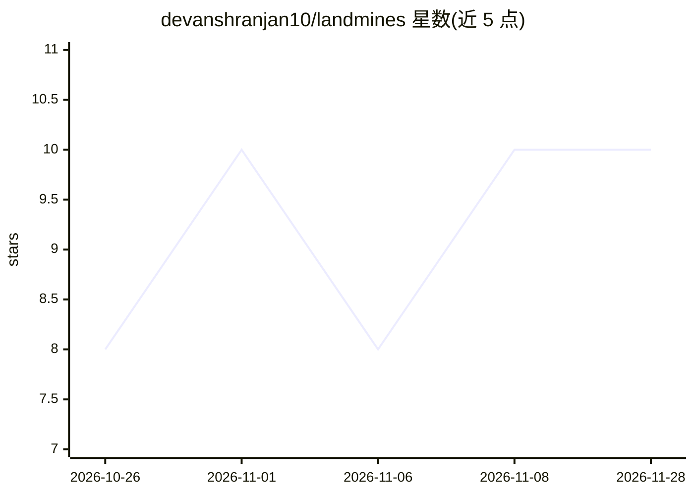

# devanshranjan10/landmines

⭐ 10 · TypeScript · MIT · 推送 2026-10-31 · [GitHub](https://github.com/devanshranjan10/landmines) · [官网](https://landmine.tech) · 个人维护

**给编码代理拦截已知依赖 bug 的预编辑钩子与 MCP 服务**

landmines 读取项目 lockfile，检索与所固定版本完全对应的开放 GitHub issue，生成索引并写入触发卡片；install 命令为项目中的编码代理（20 种）添加预编辑钩子、规则段落、Agent Skill 或 MCP 服务器。钩子离线运行，仅在编辑命中 issue 涉及的符号且文件匹配具体条件时拦截一次并提供 issue 与 workaround。README 附带基准测试数据，并注明预编辑钩子相对无辅助提升不显著，建议从 scan + install --rules 起步。

## 筛选速览

| 维度 | 判定 | 备注 |
|---|---|---|
| AI 角色 | `ai-ecosystem` | LLM/agent 周边工具 |
| 许可风险 | `permissive` | MIT |
| 部署形态 | `library` | 以包/库形式分发 |
| 模型依赖 | — | README 未给出锁定关系 |
| 硬件要求 | — | 无带数字的原话,不猜 |
| 安装摩擦 | `low` | 无编译、无系统依赖或容器化 |
| 成熟度 | — | 结构信号不足 |

## 能力要点

- scan 读取 lockfile 并匹配固定精确版本的开放 GitHub issue
- install 为 20 种编码代理写入预编辑钩子、规则段或 MCP 服务器
- 钩子离线运行，README 称单次调用约 0.11 秒，无需调用模型
- 提供本地 stdio MCP 与托管 HTTP MCP 两种查询方式

## 适用场景

- 在编码代理编辑代码前拦截其使用已知损坏版本 API 的修改
- 把依赖的已知 bug 摘要写入 AGENTS.md/CLAUDE.md 供代理读取
- 通过 MCP 按需查询某个错误是否为已固定版本的已知 bug

## 场景标签

`编码 Agent` · 领域:编码与开发

## 证据(README 行号)

> L24: - **`landmine scan`.**
> L30: - **`landmine install`.** Adds a pre-edit hook (or plugin) for the coding agents it finds
> L37: - **`landmine mcp`.** An MCP server the agent can query on demand ("is this error a

## 星数曲线

2026-10-26 8 → 2026-11-28 10（+2）

---
*卡片 v1 · prompt 1.4 · 生成 2026-11-19 · 置信度 mid · 依据 README sha `75156afa6cea` · [字段定义](../../DATASET.md)*
