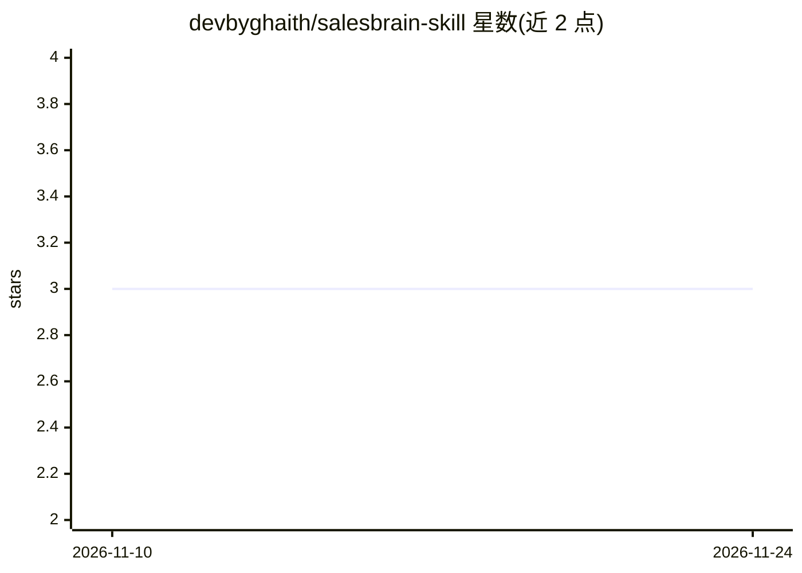

# devbyghaith/salesbrain-skill

⭐ 3 · Python · MIT · 推送 2026-11-06 · [GitHub](https://github.com/devbyghaith/salesbrain-skill) · 个人维护

**给 AI agent 提供证据分级的销售判断技能包**

面向 Claude Code 及兼容 agentskills.io 格式 agent 的 Agent Skill：将销售规则按 study/data/practitioner/opinion 标注证据等级，数字注明出处，并标记与研究相悖的流行建议。覆盖发现、异议、成交谈判、外联、报价定价、演示等场景。通过 git clone 或 plugin install 安装到技能目录后自动按任务触发。它定位为判断层，不抓取 CRM 数据、不 enrich 线索、不发送邮件；语料审核层核对 DOI 与复现结果，未通过的结论记录在 claims-audit.md 供 agent 回避。

## 筛选速览

| 维度 | 判定 | 备注 |
|---|---|---|
| AI 角色 | `ai-knowledge` | 知识聚合/清单类 |
| 许可风险 | `permissive` | MIT |
| 部署形态 | `None` |  |
| 模型依赖 | — | README 未给出锁定关系 |
| 硬件要求 | — | 无带数字的原话,不猜 |
| 安装摩擦 | `low` | 无编译、无系统依赖或容器化 |
| 成熟度 | — | 结构信号不足 |

## 能力要点

- 每条规则标注证据等级，每个数字注明出处
- 对照 DOI 与复现研究审核 41 条声明，14 条通过、12 条夸大、2 条复现失败
- 提供 8 个案例的 with/without 消融评测套件与成本上限参数
- 支持技能目录克隆或 Claude Code 插件两种安装方式

## 适用场景

- 让销售 agent 在降价前先向客户提问澄清
- 为报价谈判邮件起草有依据的回复
- 审核销售话术建议是否有研究支撑

## 场景标签

`提示工程` `模型评测` · 领域:Agent 开发

## 证据(README 行号)

> L3: **An Agent Skill that gives any AI agent evidence-graded sales judgment: every rule tagged study, data, practitioner
> L9: persuasion research, sales process and team, mindset. The skill is the judgment layer; it does not fetch
> L55: - 55 talks and interviews and 26 studies, ingested into a notes layer (transcripts, per-source notes,

## 星数曲线

2026-11-10 3 → 2026-11-24 3（+0）

---
*卡片 v1 · prompt 1.4 · 生成 2026-11-22 · 置信度 high · 依据 README sha `060b60c4bf66` · [字段定义](../../DATASET.md)*
