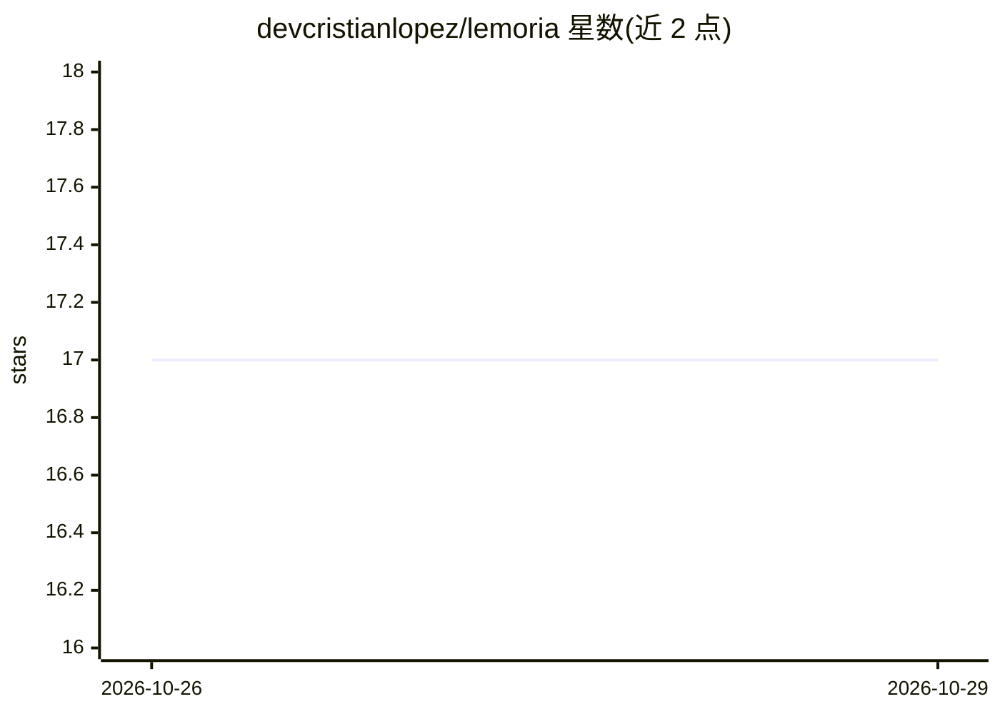

# devcristianlopez/lemoria

⭐ 17 · Python · MIT · 推送 2026-10-26 · [GitHub](https://github.com/devcristianlopez/lemoria) · [官网](https://lemoria.org/) · 个人维护

**为 AI 辅助开发提供持久记忆与 SDD 编排的 CLI 系统**

Python CLI 工具，面向使用 OpenCode 的开发者：将开发流程组织为 15 步 Spec Driven Development（发现→PRD→任务→实现→测试→提交→文档→记忆更新），由编排 agent 委派 8 个专用 agent 执行。每个项目、PRD、任务、决策与流程步骤持久化到 PostgreSQL（原生或 Docker），实现全链路可追溯；commit 通过消息尾注关联任务。可选与 Obsidian vault 双向同步，vault 存于仓库外并自动加入 .gitignore。提供 agent 模型固定与按 agent 的会话/token 遥测。需 Python 3.11+、uv、PostgreSQL 14+。

## 筛选速览

| 维度 | 判定 | 备注 |
|---|---|---|
| AI 角色 | `ai-ecosystem` | LLM/agent 周边工具 |
| 许可风险 | `permissive` | MIT |
| 部署形态 | `library` | 以包/库形式分发 |
| 模型依赖 | — | README 未给出锁定关系 |
| 硬件要求 | — | 无带数字的原话,不猜 |
| 安装摩擦 | `low` | 无编译、无系统依赖或容器化 |
| 成熟度 | — | 结构信号不足 |

## 能力要点

- 15 步 SDD 流程 + 状态机，可从中断处恢复流程
- 8 个 OpenCode agent（orchestrator 委派 implementation/frontend/DB/testing/GitHub/review/documentation）
- 项目、PRD、任务、决策、flow step 全量持久化到 PostgreSQL
- Obsidian vault 双向同步，vault 自动保护不入 git

## 适用场景

- 让 OpenCode agent 按规范流程（PRD→任务→commit）实现功能
- 跨项目保存 AI 开发记忆与决策记录（ADR）
- 按 agent 查看模型配置与 token 消耗
- 把开发记录导出到 Obsidian 浏览追溯

## 场景标签

`Agent 记忆` `Agent 框架` · 领域:Agent 开发

## 证据(README 行号)

> L14: **Lemoria** es una herramienta CLI en Python que convierte tu flujo de desarrollo en un proceso trazable, orquestad
> L21: - 🤖 **8 agentes OpenCode** — Un orquestador que delega automáticamente a agentes especializados (implementation, fr
> L128: Lemoria incluye **8 agentes** en inglés, sin dependencia de lenguaje/framework. El `orchestrator` es el agente por

## 星数曲线

2026-10-26 17 → 2026-10-29 17（+0）

---
*卡片 v1 · prompt 1.4 · 生成 2026-10-29 · 置信度 mid · 依据 README sha `93270a46c0c6` · [字段定义](../../DATASET.md)*
