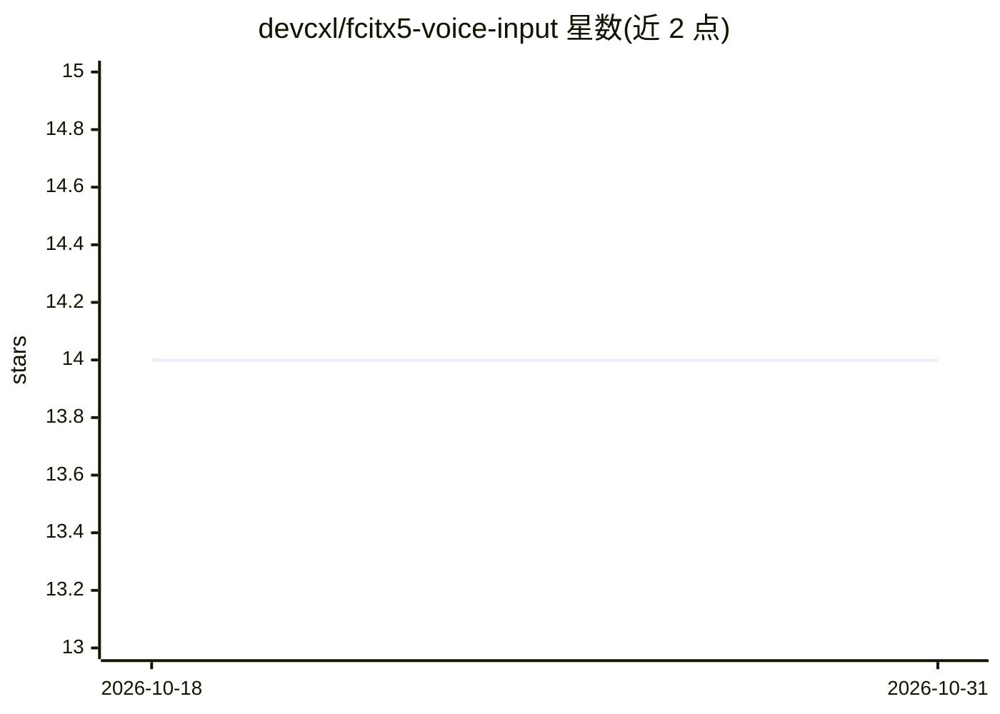

# devcxl/fcitx5-voice-input

⭐ 14 · C++ · NOASSERTION · 推送 2026-10-26 · [GitHub](https://github.com/devcxl/fcitx5-voice-input) · [官网](https://devcxl.github.io/fcitx5-voice-input/) · 个人维护 · 中文 README

**Fcitx5 语音输入插件：VAD 分段后经云端 ASR 转文字上屏**

Linux 输入法框架 Fcitx5 的 C++20 插件：通过 PulseAudio/PipeWire 采集音频，用 Silero ONNX VAD 自动切分语音段（无需按键说话），再经 OpenAI 兼容接口（Whisper/Chat/Realtime 三种模式）、火山引擎豆包流式 ASR 或 Mistral Realtime 转写，实时部分结果显示在预编辑区并最终提交上屏；支持可选的 LLM 后处理。面向 Linux 桌面使用者，需自备 API Key 且依赖联网，本地 ASR 尚未实现（已预留 AsrEngine/AsrSession 接口）。

## 筛选速览

| 维度 | 判定 | 备注 |
|---|---|---|
| AI 角色 | `ai-native` | 本体是模型或模型工具 |
| 许可风险 | `none` | NOASSERTION |
| 部署形态 | `None` |  |
| 模型依赖 | — | README 未给出锁定关系 |
| 硬件要求 | — | 无带数字的原话,不猜 |
| 安装摩擦 | `medium` | 含编译或系统依赖之一 |
| 成熟度 | `idea` | |

## 能力要点

- Silero ONNX VAD 自动分段，无需按键说话
- 三种 ASR 后端：OpenAI 兼容 / 火山引擎豆包流式 / Mistral Realtime
- 流式后端支持说话中实时部分结果更新
- 多线程队列管线（采集→VAD→ASR→结果协调→提交）

## 适用场景

- Linux 桌面下用语音代替打字输入文字
- 中文语音听写并自动上屏到任意应用
- 利用 LLM 后处理对识别文本做格式修正

## 场景标签

`语音识别` · 领域:感知与多模态

## 证据(README 行号)

> L13: **fcitx5-voice-input** is a Fcitx5 addon for voice input. Captures audio via PulseAudio (or PipeWire fallback), det
> L18: - Silero ONNX VAD for automatic speech segmentation (no push-to-talk required)
> L20: - Queue-based pipeline: Audio Capture → VAD → ASR → EventDispatcher → commit

## 星数曲线

2026-10-18 14 → 2026-10-31 14（+0）

---
*卡片 v1 · prompt 1.4 · 生成 2026-10-31 · 置信度 high · 依据 README sha `e0a3a44154cb` · [字段定义](../../DATASET.md)*
