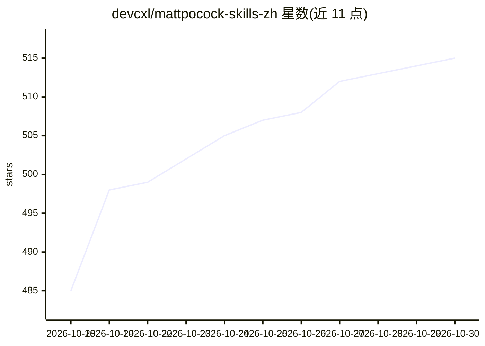

# devcxl/mattpocock-skills-zh

⭐ 515 · Shell · MIT · 推送 2026-10-29 · [GitHub](https://github.com/devcxl/mattpocock-skills-zh) · 个人维护 · 中文 README

**面向工程实践的 AI 编程智能体技能集中文翻译版**

Matt Pocock mattpocock/skills 的第三方简体中文汉化版，由 devcxl 维护并每日同步，非官方仓库。收录面向编码智能体的技能集，分 Engineering 与 Productivity 两类，含用户调用与模型调用两种触发方式，覆盖盘问对齐（/grill-me）、测试驱动开发（/tdd）、代码评审、架构扫描、领域建模等场景。通过 Claude Code、Codex、Copilot、Gemini CLI 插件市场或 npx skills 安装器接入各智能体，中文版安装路线部分尚未逐项实测。

## 筛选速览

| 维度 | 判定 | 备注 |
|---|---|---|
| AI 角色 | `ai-knowledge` | 知识聚合/清单类 |
| 许可风险 | `permissive` | MIT |
| 部署形态 | `library` | 以包/库形式分发 |
| 模型依赖 | — | README 未给出锁定关系 |
| 硬件要求 | — | 无带数字的原话,不猜 |
| 安装摩擦 | `low` | 无编译、无系统依赖或容器化 |
| 成熟度 | `idea` | |

## 能力要点

- 技能按用户调用/模型调用两类组织，覆盖对齐、TDD、评审、架构等工程实践
- 兼容多种智能体：Claude Code、Codex、Copilot、Gemini CLI、Cursor 等
- 提供 setup 安装向导配置 Issue 跟踪器、triage 标签与文档布局
- 每日中午 12 点与上游英文仓库同步

## 适用场景

- 在编码智能体中使用盘问会话在开工前对齐需求
- 让智能体按红绿重构循环做测试驱动开发
- 定期扫描代码库寻找架构深化机会
- 为智能体编写和维护项目共享语言（术语表、ADR）

## 场景标签

`提示工程` · 领域:Agent 开发

## 证据(README 行号)

> L11: 本仓库由 `devcxl` 维护，是 Matt Pocock 的 `mattpocock/skills` 项目的第三方简体中文汉化版，非官方仓库。以下中文版安装方式均指向本仓库；英文原版见上游仓库。
> L197: ## 索引
> L199: 这些按一个维度划分：谁能触发它们。**用户调用**的技能只有在你键入它们时才可达（例如 `/grill-me`）；它们的职责是编排。**模型调用**的技能可以由你触发，或者在任务契合时由智能体自动拿起来用；它们承载着可复用的纪律

## 星数曲线

2026-10-18 485 → 2026-10-30 515（+30）

---
*卡片 v1 · prompt 1.4 · 生成 2026-10-21 · 置信度 high · 依据 README sha `31da9cdc784b` · [字段定义](../../DATASET.md)*
