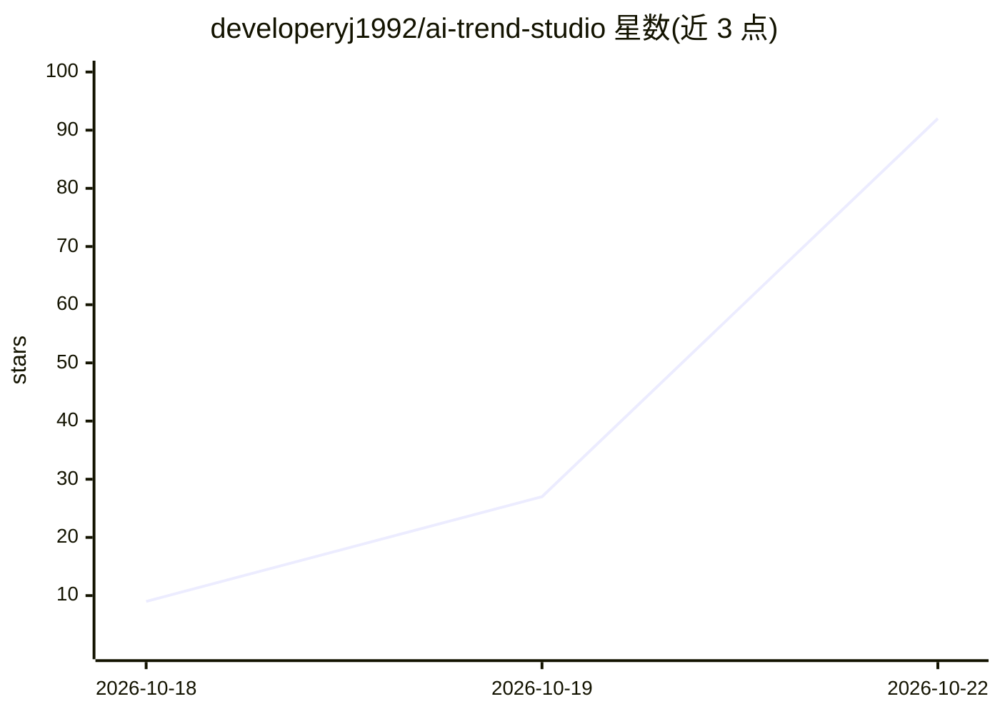

# developeryj1992/ai-trend-studio

⭐ 82 · Python · MIT · 推送 2026-10-13 · [GitHub](https://github.com/developeryj1992/ai-trend-studio) · 个人维护 · 中文 README

**本地优先的 AI 趋势雷达与直播内容结构化摘要工具**

运行在本机的 Python 应用：采集抖音、B 站、微博、知乎的公开热点与直播房间元数据，按 AI 关键词过滤，将视频描述、字幕、评论或笔记蒸馏为要点，支持多发言人直播记录与结构化简报（结论/行动/风险）。默认内置中文抽取式摘要器，离线无需 API key，可选配置任意 OpenAI 兼容端点生成更高质量摘要。仅用 Python 标准库，无运行时依赖，数据存于本地 JSON 文件；明确不做验证码破解或受保护内容下载。

## 筛选速览

| 维度 | 判定 | 备注 |
|---|---|---|
| AI 角色 | `ai-native` | 本体是模型或模型工具 |
| 许可风险 | `permissive` | MIT |
| 部署形态 | `None` |  |
| 模型依赖 | — | README 未给出锁定关系 |
| 硬件要求 | — | 无带数字的原话,不猜 |
| 安装摩擦 | `low` | 无编译、无系统依赖或容器化 |
| 成熟度 | — | 结构信号不足 |

## 能力要点

- 抖音/B站/微博/知乎公开热点采集与 AI 关键词过滤
- 内置离线中文抽取式摘要器，无需 API key
- 多发言人直播记录与结构化简报（结论/行动/风险）
- 纯标准库实现，无 Python 运行时依赖，数据存本地 JSON

## 适用场景

- 追踪各平台上受关注的 AI 产品、模型与用例
- 把视频或直播内容整理成要点和结构化简报再分享给团队
- 在不上传原始资料到云端的前提下维护私人研究笔记

## 场景标签

`知识库管理` `网页抓取` `AI 写作` · 领域:效率与自动化

## 证据(README 行号)

> L10: AI Trend Studio collects public hot-topic signals, distills video and note content, and turns live sessions into st
> L33: - **Offline-first:** A built-in Chinese extractive summarizer runs without an API key.

## 星数曲线

2026-10-18 9 → 2026-10-22 92（+83）

---
*卡片 v1 · prompt 1.4 · 生成 2026-10-25 · 置信度 high · 依据 README sha `b3f8874fdae7` · [字段定义](../../DATASET.md)*
