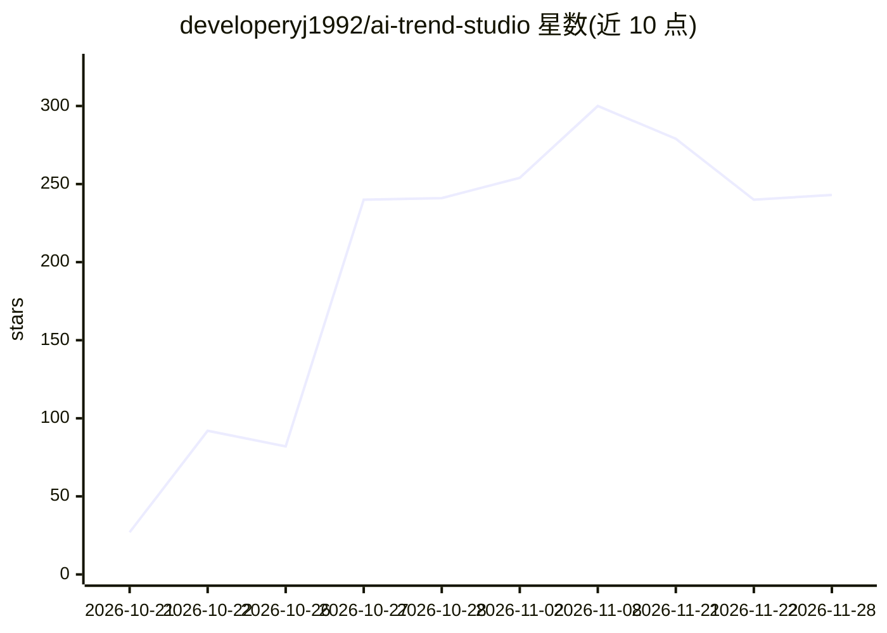

# developeryj1992/ai-trend-studio

⭐ 243 · Python · MIT · 推送 2026-11-01 · [GitHub](https://github.com/developeryj1992/ai-trend-studio) · 个人维护 · 中文 README

**本地优先的 AI 热点雷达与直播内容结构化笔记工具**

面向关注 AI 动态的个人用户：从抖音、B 站、微博、知乎等公开接口采集热点信号，按关键词过滤，将视频简介、字幕（SRT/VTT）、评论、笔记等文本蒸馏为要点；支持直播中按发言人记录会话并生成含结论、行动项与风险的结构化简报。内置无 API key 的中文抽取式摘要器，可选配置任意 OpenAI 兼容 /chat/completions 端点获得模型摘要。仅依赖 Python 3.10+ 标准库，数据存于本地单个 JSON 文件。

## 筛选速览

| 维度 | 判定 | 备注 |
|---|---|---|
| AI 角色 | `ai-native` | 本体是模型或模型工具 |
| 许可风险 | `permissive` | MIT |
| 部署形态 | `None` |  |
| 模型依赖 | — | README 未给出锁定关系 |
| 硬件要求 | — | 无带数字的原话,不猜 |
| 安装摩擦 | `low` | 无编译、无系统依赖或容器化 |
| 成熟度 | — | 结构信号不足 |

## 能力要点

- 内置无 API key 的中文抽取式摘要器，离线可用
- 配置任意 OpenAI 兼容 /chat/completions 端点生成模型摘要
- 直播会话按发言人记录，支持语音/字幕/评论/洞察事件类型
- 零 Python 依赖，数据存本地 data/db.json，API key 不进导出

## 适用场景

- 追踪 AI 产品、模型与用例的热度变化
- 把视频蒸馏成要点后再分享给团队
- 将课程、 webinar 或多人直播记录为结构化笔记
- 不把每个来源上传云服务的情况下保留私人研究日志

## 场景标签

`知识库管理` · 领域:知识与检索

## 证据(README 行号)

> L10: AI Trend Studio collects public hot-topic signals, distills video and note content, and turns live sessions into st
> L33: - **Structured summaries:** Core conclusion, key points, action items, risks, keywords, and stats.
> L36: - **Model-agnostic:** Configure any OpenAI-compatible `/chat/completions` endpoint.

## 星数曲线

2026-10-21 27 → 2026-11-28 243（+216）

---
*卡片 v1 · prompt 1.4 · 生成 2026-11-25 · 置信度 high · 依据 README sha `b9fd6e274eed` · [字段定义](../../DATASET.md)*
